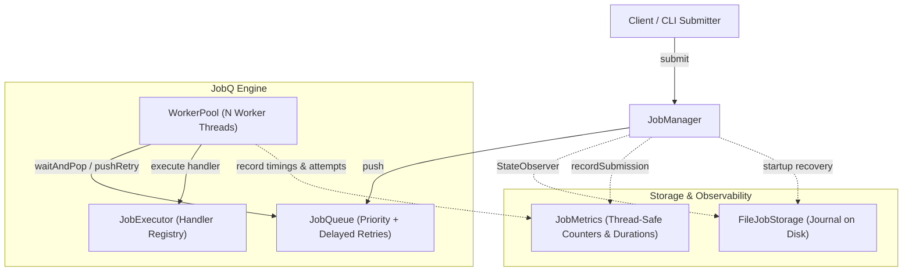

# JobQ

**JobQ** is a high-performance, multithreaded job queue and execution engine implemented in modern **C++20**. It provides in-process task scheduling, priority queues with deterministic FIFO tie-breaking, worker pool concurrency, automated exponential backoff retries, append-only persistence with crash recovery, a command-line interface, and structured JSON observability.

Conceptually inspired by task processing systems like Celery and BullMQ, JobQ brings structured asynchronous background task processing to native C++ applications with zero external runtime dependencies.

---

## Key Features

- **Priority-Based Scheduling:** Three scheduling tiers (`High`, `Normal`, `Low`) with guaranteed FIFO ordering for equal priorities using monotonic sequence numbering.
- **Worker Pool Concurrency:** Multi-threaded worker pool consuming from a thread-safe queue with coordinated graceful shutdown and thread joining.
- **Resilient Execution & Handlers:** Decoupled `JobExecutor` registry mapping string task types to callable handlers; worker threads isolate exceptions and never terminate on job failure.
- **Exponential Backoff Retries:** Configurable `RetryPolicy` with delayed retry min-heaps and timed condition variable waiting (no busy-waiting or thread spinning).
- **Append-Only Journal Persistence:** Durable file storage (`FileJobStorage`) with automatic repair and truncation of incomplete file tails caused by power failure or hard kills.
- **Crash Recovery:** Startup recovery pipeline reconciling latest job states and automatically re-enqueuing interrupted and pending tasks.
- **Multi-Command CLI:** Full-featured command-line tool (`jobq_cli`) supporting `submit`, `list`, `status`, `run`, and `metrics` commands.
- **Metrics & Observability:** Thread-safe execution counters, monotonic latency measurements (`steady_clock`), real-time throughput calculations, and Schema Version 1 structured JSON export.
- **Comprehensive Testing:** 24 automated test suites integrated with CTest, including multi-threaded concurrency proofs using `std::latch`.

---

## Technology Stack

- **Language:** Standard C++20 (`std::thread`, `std::mutex`, `std::condition_variable`, `std::shared_mutex`, `std::latch`, `std::chrono`)
- **Build System:** CMake 3.20+
- **Compiler:** GCC 13+ / 14+ (MSYS2 MinGW UCRT64 on Windows; GCC 11+ or Clang 13+ on Linux)
- **Persistence:** Local append-only text journal
- **Testing:** CTest test runner
- **External Dependencies:** **None** (100% C++ Standard Library)

---

## High-Level Architecture



---

## Quick Start

### 1. Prerequisites
Ensure you have a modern C++20 compiler and CMake 3.20+ installed. On Windows, the recommended environment is **MSYS2 MinGW UCRT64**.

For detailed setup instructions, see the [Installation Guide](docs/installation.md).

### 2. Configure and Build
```powershell
# Clone the repository
git clone https://github.com/chaten99/JobQ.git
cd JobQ

# Configure with CMake
cmake -S . -B build

# Build all binaries and tests
cmake --build build
```

### 3. Run Automated Tests
```powershell
ctest --test-dir build --output-on-failure
```
All 24 automated test suites should pass cleanly.

---

## CLI Usage

The CLI executable is located at `build/jobq_cli.exe`.

### Submit a Job
```powershell
.\build\jobq_cli.exe submit --type REPORT --payload "monthly-summary" --priority high --retries 3 --storage data/demo.journal
```

### List Tracked Jobs
```powershell
.\build\jobq_cli.exe list --storage data/demo.journal
```

### Inspect a Specific Job
```powershell
.\build\jobq_cli.exe status 1 --storage data/demo.journal
```

### Run Worker Pool with JSON Metrics
```powershell
.\build\jobq_cli.exe run --workers 2 --storage data/demo.journal --format json
```

Example JSON output:
```json
{
  "schemaVersion": 1,
  "metrics": {
    "submittedJobs": 0,
    "startedExecutions": 1,
    "completedExecutions": 1,
    "failedExecutions": 0,
    "scheduledRetries": 0,
    "finishedExecutions": 1
  },
  "performance": {
    "totalExecutionTimeNs": 5469100,
    "averageExecutionTimeNs": 5469100,
    "elapsedTimeNs": 20692800,
    "throughputJobsPerSecond": 48.32598778
  }
}
```

For full CLI documentation, see the [CLI Reference](docs/cli-reference.md).

---

## C++ API Quick Example

Embedding JobQ into your own C++20 application:

```cpp
#include <iostream>
#include <chrono>
#include "executor/JobExecutor.h"
#include "manager/JobManager.h"
#include "queue/JobQueue.h"
#include "worker/WorkerPool.h"

int main() {
    using namespace jobq;

    JobQueue queue;
    JobExecutor executor;

    // Register a handler
    executor.registerHandler("EMAIL", [](const Job& job) {
        std::cout << "Sending email: " << job.getPayload() << "\n";
    });

    // Start 2 workers
    WorkerPool pool(queue, executor, 2);
    pool.start();

    // Submit work via JobManager
    JobManager manager(queue);
    manager.submit("EMAIL", R"({"to":"alice@example.com"})", JobPriority::High);

    // Stop gracefully
    std::this_thread::sleep_for(std::chrono::milliseconds(100));
    pool.stop();

    return 0;
}
```

For more examples, see the [C++ API Developer Guide](docs/api-usage.md).

---

## Reliability & Fault Tolerance

JobQ is designed so that accepted jobs are not silently lost when a handler throws, storage fails or the queue closes. In short:

- **Graceful shutdown:** `WorkerPool::stop()` closes the queue, drains every accepted job (including delayed retries), then joins the workers. Repeated and concurrent calls are safe.
- **Worker lifecycle:** workers are single-use, exceptions never escape a worker thread, and a failed pool start rolls back cleanly.
- **Queue:** one mutex guards all queue state; a submission racing a close is exactly accepted or rejected.
- **Persistence and recovery:** an append-only journal with validated records; recovery validates everything first, retries interrupted jobs and fails fast on corruption.
- **Fault injection:** a dedicated test suite deliberately breaks handlers, storage, the queue and workers.

What JobQ does **not** provide: exactly-once execution (it is at-least-once), cross-process or distributed coordination, `fsync`-level durability, handler timeouts, or persisted metrics. Handlers should be idempotent.

| Guide | Contents |
|---|---|
| [Reliability](docs/reliability.md) | Overview, guarantees table, known limitations. |
| [Graceful Shutdown](docs/graceful-shutdown.md) | The close-and-drain policy and its edge cases. |
| [Worker Lifecycle](docs/worker-lifecycle.md) | Worker and pool states, startup rollback, concurrency contract. |
| [Queue Reliability](docs/queue-reliability.md) | Concurrency, closure, ordering and delayed-retry behaviour. |
| [Fault Tolerance](docs/fault-tolerance.md) | Failure scenarios, fault-handling matrix, known gaps. |
| [Troubleshooting](docs/troubleshooting.md) | Diagnosing build, runtime and persistence problems safely. |

---

## Project Structure

```text
JobQ/
CMakeLists.txt              # CMake configuration and CTest test targets
README.md                   # This project overview
CONTRIBUTING.md             # Developer workflow and guidelines
docs/                       # Full project documentation suite
include/                    # Public C++20 headers
cli/                    # CLI parsing and command dispatch
executor/               # JobExecutor handler registry
job/                    # Job model, status, priority, and retry policy
manager/                # JobManager and in-memory registry
metrics/                # JobMetrics and JSON export
queue/                  # JobQueue priority queue and delayed retries
storage/                # FileJobStorage and JobRecord
worker/                 # Worker thread and WorkerPool
src/                        # Implementations and main entry points
tests/                      # 24 standalone automated test drivers
examples/                   # Stress test and concurrency benchmark programs
```

---

## Documentation Navigation

Detailed technical documentation is available in the [`docs/`](docs/README.md) directory:

| Document | Description |
|---|---|
| [Installation & Setup](docs/installation.md) | Toolchain setup, CMake configuration, and troubleshooting. |
| [System Architecture](docs/architecture.md) | Component responsibilities, Mermaid flowcharts, and concurrency model. |
| [Project Structure](docs/project-structure.md) | Directory layouts, header organization, and file responsibilities. |
| [Job Lifecycle](docs/job-lifecycle.md) | Finite state machine, transitions, attempt counters, and snapshots. |
| [Queue & Workers](docs/queue-and-workers.md) | Priority heaps, sequence FIFO tie-breaking, and worker loops. |
| [Retry System](docs/retry-system.md) | Exponential backoff formula, delayed scheduling, and failure recovery. |
| [Persistence & Recovery](docs/persistence-and-recovery.md) | File journals, incomplete tail repair, and crash recovery pipeline. |
| [Reliability](docs/reliability.md) | Guarantees, limitations, and links to the shutdown, worker, queue and fault-tolerance guides. |
| [Troubleshooting](docs/troubleshooting.md) | Build, runtime and persistence diagnostics. |
| [CLI Reference](docs/cli-reference.md) | Command syntax, arguments, options, and exit codes. |
| [Metrics & Observability](docs/metrics-and-observability.md) | Counters, monotonic latency timers, throughput, and JSON export. |
| [C++ API Usage](docs/api-usage.md) | Real C++20 code samples for embedding JobQ. |
| [Examples & Demos](docs/examples.md) | Running stress tests and in-process runtime benchmarks. |
| [Testing Guide](docs/testing.md) | Catalog of the 24 CTest test suites and how to add new tests. |
| [Design Decisions](docs/design-decisions.md) | Architectural trade-offs and rationale. |
| [Project Status & Roadmap](docs/roadmap.md) | Verified capabilities vs. planned future milestones. |
| [Contributing Guide](CONTRIBUTING.md) | Development standards, coding style, and PR process. |

---

## Current Status & Limitations

### Completed (Phases 8 and 9)
- Phase 9 reliability work: graceful shutdown, worker lifecycle hardening, queue reliability, persistence and recovery hardening, and fault-injection testing (see [Reliability](docs/reliability.md)).
- Fully functioning in-process background job processing engine.
- Single-host file journal persistence and crash recovery.
- Multi-command CLI and Schema v1 JSON runtime metrics.
- 24/24 passing automated CTest test suites.

### Current Limitations
- **Single Process / Local Host:** JobQ currently coordinates jobs within a single process. It does not provide distributed queue coordination across multiple independent server processes or network clusters.
- **In-Memory Metrics:** Runtime metrics are accumulated in memory during a worker run; historical metrics do not survive process restarts.
- **Append-Only Journal:** Journal files grow append-only; log compaction (vacuuming) is scheduled for a future milestone.
- **At-Least-Once Execution:** A crash (or failed save) after a handler returns but before its `Completed` record is written can cause the handler to run again after recovery. See [Reliability](docs/reliability.md#5-known-limitations).

---

## License

This project is licensed under the MIT License.
