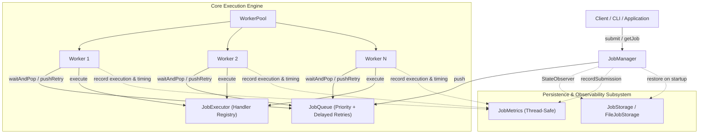
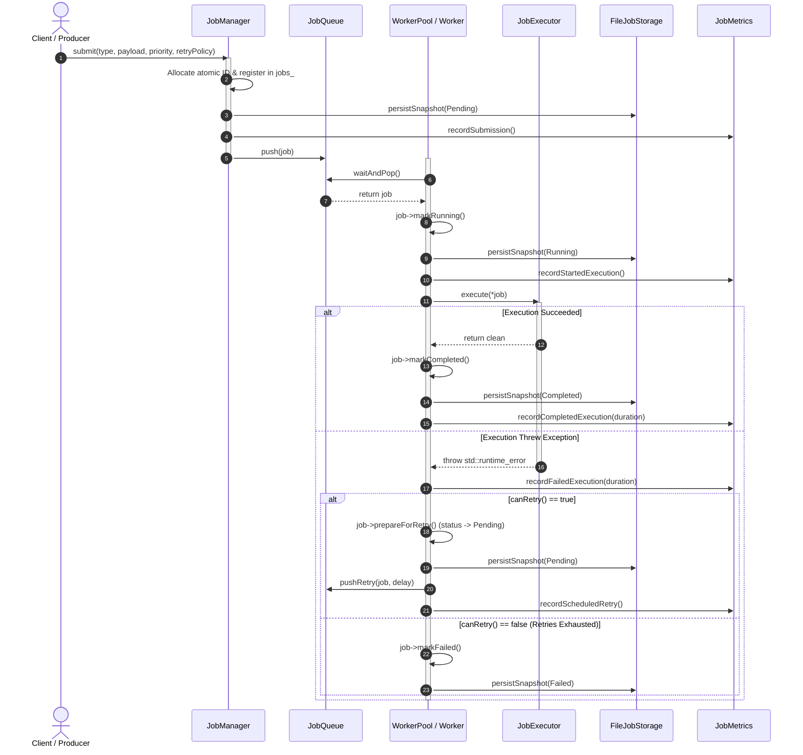
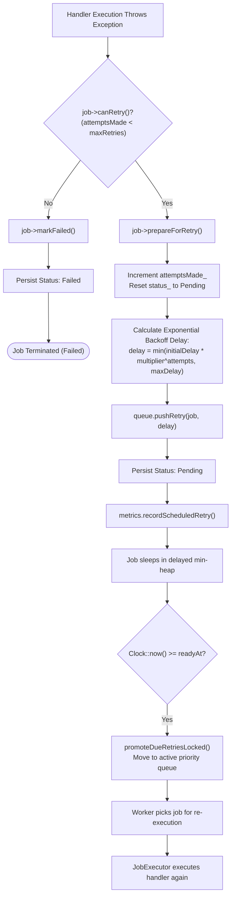
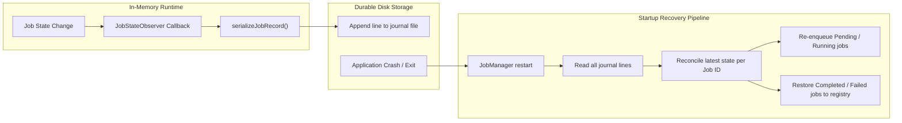

# JobQ System Architecture

JobQ is a multithreaded, in-process job queue and execution engine implemented in modern C++20. This document details the component architecture, execution pipelines, data flow, threading models, and subsystem interactions.

---

## 1. High-Level Architecture Overview

JobQ is structured around decoupled, single-responsibility components communicating through thread-safe queues and observer interfaces.

---

## 2. Core Components & Responsibilities

| Component | Header / Source | Primary Responsibilities |
|---|---|---|
| **Job** | `include/job/Job.h` `src/job/Job.cpp` | Encapsulates job identity (`id`), type, payload, priority, lifecycle status, retry policy, attempt counter, and state observer notification callback. |
| **JobQueue** | `include/queue/JobQueue.h` `src/queue/JobQueue.cpp` | Thread-safe scheduling queue. Provides priority ordering with FIFO tie-breaking for equal priorities, delayed retry scheduling with timed condition variable waiting, and clean shutdown signaling. |
| **JobExecutor** | `include/executor/JobExecutor.h` `src/executor/JobExecutor.cpp` | Function registry mapping job type strings to callable handlers (`std::function<void(const Job&)>`). Propagates handler failures as exceptions to workers. |
| **Worker** | `include/worker/Worker.h` `src/worker/Worker.cpp` | Worker thread consumer. Consumes jobs from `JobQueue`, transitions status to `Running`, executes handler via `JobExecutor`, marks `Completed`, or schedules retries with exponential backoff on failure. |
| **WorkerPool** | `include/worker/WorkerPool.h` `src/worker/WorkerPool.cpp` | Manages worker thread lifecycles: worker instantiation, thread startup (`start()`), and graceful stopping (`stop()`) by closing the queue and joining all worker threads. |
| **JobManager** | `include/manager/JobManager.h` `src/manager/JobManager.cpp` | Top-level job orchestrator. Generates atomic monotonic job IDs, maintains in-memory job registry (`unordered_map` with `shared_mutex`), attaches state persistence observers, and manages startup crash recovery. |
| **FileJobStorage** | `include/storage/FileJobStorage.h` `src/storage/FileJobStorage.cpp` | Append-only text journal persistence. Saves serialized `JobRecord` snapshots and recovers historical jobs on startup, automatically repairing truncated/incomplete tails from hard crashes. |
| **JobMetrics** | `include/metrics/JobMetrics.h` `src/metrics/JobMetrics.cpp` | Thread-safe runtime metrics collector tracking job submissions, execution attempts, completions, failures, retries, monotonic execution durations, and real-time throughput. |
| **JobMetricsJson** | `include/metrics/JobMetricsJson.h` `src/metrics/JobMetricsJson.cpp` | Serializes immutable `JobMetricsSnapshot` structs into valid JSON adhering to schema version 1 with nanosecond precision integers and safe floating-point throughput handling. |
| **CLI Engine** | `include/cli/CommandLine.h` `src/cli/CommandHandlers.cpp` | Robust command line parser and execution handlers supporting subcommands (`submit`, `list`, `status`, `run`, `metrics`) with text and JSON output formats. |

---

## 3. Job Execution Lifecycle Flow

The complete flow of a job from submission through worker dispatch, handler execution, and final status reporting:

---

## 4. Retry and Backoff Subsystem

When a job handler fails during execution, JobQ invokes the retry subsystem rather than immediately abandoning the task:

### Delayed Queue Mechanics
- `JobQueue` maintains two internal queues:
  1. `jobs_`: Active priority queue ready for immediate consumption.
  2. `delayedRetries_`: Min-heap ordered by `readyAt` (`std::chrono::steady_clock::time_point`).
- When a worker calls `waitAndPop()`:
  - Any delayed entries whose `readyAt <= steady_clock::now()` are automatically promoted to `jobs_`.
  - If `jobs_` is empty but `delayedRetries_` has pending items, the calling thread waits on `std::condition_variable` with a predicate timed to wake up at the earliest `readyAt`.
  - Avoids busy-waiting loops and thread spinning entirely.

---

## 5. Persistence and Recovery Architecture

JobQ uses an **append-only journal** approach for durable job records:

### Crash Recovery Guarantees
- **Incomplete Tail Repair:** If the process is forcefully terminated midway through writing a line, `FileJobStorage` identifies and truncates the corrupted tail record during initialization.
- **Last-Write-Wins:** Because state transitions append new snapshots to the journal, reading from top to bottom results in the last record reflecting the final known state.
- **Interrupted Job Recovery:** Jobs that were `Running` at the time of a crash are restored back to `Pending` so that surviving retries or executions can be resumed upon restart.

---

## 6. Concurrency and Thread Safety Model

JobQ is engineered for safe multi-threaded concurrency without race conditions:

| Component | Synchronization Primitives | Invariants Protected |
|---|---|---|
| `Job` | `mutable std::mutex statusMutex_` | Thread-safe status transitions, attempt counting, and atomic snapshots even during concurrent inspection. |
| `JobQueue` | `mutable std::mutex mutex_` `std::condition_variable notEmptyCv_` | Atomicity of priority heap pushes/pops, FIFO sequence ordering, delayed queue promotions, and graceful shutdown notification. |
| `JobManager` | `std::atomic<uint64_t> nextId_` `mutable std::shared_mutex registryMutex_` | Lock-free unique ID generation; multiple concurrent readers (`getJob`, `getStatus`) with exclusive writer locks for submissions. |
| `JobExecutor` | `mutable std::mutex mutex_` | Safe handler registration and execution lookups. |
| `FileJobStorage` | `std::mutex mutex_` | Serialized disk write operations, preventing interleaved or corrupted journal lines across threads. |
| `JobMetrics` | `mutable std::mutex mutex_` `std::atomic<uint64_t>` | Thread-safe execution counters, execution duration tracking, and immutable snapshot capture. |
