# Throughput Benchmarking

`jobq_throughput_benchmark` measures how many jobs per second the real JobQ engine processes end to end. It is the first step of Phase 10 and establishes a **baseline**; it does not optimize anything, and it is not a CI gate (no pass/fail performance threshold exists).

---

## 1. Purpose

- Provide a reproducible way to compare worker counts, workloads and future changes on the same machine.
- Verify correctness while measuring: a run only produces a throughput number if every accepted job completed exactly once.
- Queue-wait and execution latency statistics (section 10) and worker-scaling comparisons (section 11) are built into the same tool.
- Queue stress testing (section 12) and concurrency/contention analysis (section 13) are provided by separate executables. The 10.6 optimization and regression measurements are documented in section 16 and [the performance report](performance-baseline.md).

---

## 2. Architecture

Source: `benchmarks/throughput_benchmark.cpp` (CMake target `jobq_throughput_benchmark`). It links the production sources (`${JOBQ_CORE_SOURCES}`) unchanged; there is no fake queue or mock worker.

Each run builds a fresh runtime:

```mermaid
flowchart LR
    Silence["Silence stdout/stderr"] --> Rt["JobQueue + JobMetrics<br>JobManager + JobExecutor"]
    Rt --> Pool["WorkerPool (N workers)<br>shares the same JobMetrics"]
    Pool --> Start["pool.start()"]
    Start --> T0(["t0 = steady_clock::now()"])
    T0 --> Submit["manager.submit() x jobs"]
    Submit --> Stop["pool.stop()<br>close queue, drain, join"]
    Stop --> T1(["t1 = steady_clock::now()"])
    T1 --> Verify["metrics snapshot + verification<br>(not timed)"]
```



`JobManager` and `WorkerPool` use the in-memory configuration (no `JobStorage`), so the benchmark measures the engine, not disk I/O.

---

## 3. Scenarios

| Scenario | Job types | Work per job |
|---|---|---|
| `noop` | `NOOP` | Only a counter increment (the verification counter). Measures engine overhead: creation, submission, queue, worker hand-off, state transitions, metrics. |
| `lightweight` | `LIGHT` | 200 iterations of an integer xor-shift/multiply mix, seeded by the job ID, added to an atomic checksum. |
| `mixed` | `MIX_SMALL`, `MIX_MEDIUM`, `MIX_LARGE`, `MIX_HASH` | Deterministic mix by job ID modulo 10: 50% small (50 iterations), 30% medium (400), 10% large (1500), 10% FNV hash over 256 steps. |

All work is deterministic (no random numbers). Each handler adds its result to an atomic checksum so the compiler cannot discard it. After the run the benchmark recomputes the expected checksum single-threaded (outside the timed region) and fails the run on a mismatch.

---

## 4. Command-Line Options

```text
--jobs N          Jobs per measured run, 1..2000000          (default 10000)
--workers N       Worker threads, 1..256                     (default 4)
--scenario NAME   noop | lightweight | mixed                 (default noop)
--runs N          Measured runs, 1..100                      (default 3)
--warmup-jobs N   Jobs in the unmeasured warmup, 0..2000000  (default 1000; 0 disables)
--no-latency      Disable latency collection (throughput only)
--worker-counts L Worker-scaling mode, e.g. 1,2,4,8,16 (excludes --workers)
--help            Show usage
```

Both `--name value` and `--name=value` are accepted. Numbers must be complete, non-negative decimal integers (no sign, suffix or whitespace); anything else is rejected with an error message and exit code 2. The upper limits keep memory bounded: every submitted job stays in the `JobManager` registry for the whole run.

Exit codes: `0` all runs succeeded (or `--help`), `1` a warmup or measured run failed, `2` invalid arguments.

---

## 5. Build and Run

```powershell
cmake -S . -B build
cmake --build build
.\build\jobq_throughput_benchmark.exe --jobs 100000 --workers 4 --scenario noop --runs 5 --warmup-jobs 1000
```

Smoke tests:

```powershell
.\build\jobq_throughput_benchmark.exe --jobs 1000 --workers 2 --scenario noop --runs 2 --warmup-jobs 100
.\build\jobq_throughput_benchmark.exe --jobs 1000 --workers 2 --scenario lightweight --runs 2 --warmup-jobs 100
.\build\jobq_throughput_benchmark.exe --jobs 1000 --workers 2 --scenario mixed --runs 2 --warmup-jobs 100
```

The benchmark is **not** registered with CTest, so `ctest` never runs it. The contention benchmark is built as `jobq_contention_benchmark` and its diagnostics collector is covered by the CTest target `jobq_contention_metrics`. The stress benchmark is built as `jobq_queue_stress_benchmark` and its bounded integration test is the CTest target `jobq_queue_stress`. The pure calculations behind the scaling mode (worker-count parsing, run summaries, speedup and efficiency) live in `benchmarks/ScalingAnalysis.h` and are covered by the CTest target `jobq_worker_scaling_statistics`; latency statistics are covered by `jobq_latency_statistics`. Neither test measures performance.

---

## 6. Methodology

### Warmup
If `--warmup-jobs` is greater than zero, one complete run with that many jobs executes first on its own runtime (queue, metrics, manager, executor, pool). It primes code paths, caches and the allocator. Its numbers are discarded; it never touches the measured runs' counters, timing or statistics. A failed warmup fails the benchmark.

### Measured runs
Every measured run constructs a fresh runtime, so counters start at zero and no state carries over.

### Timed region
- **Starts** immediately before the first `submit()` (after the pool is started and handlers are registered).
- **Ends** after `WorkerPool::stop()` returns, which closes the queue, lets workers drain all accepted jobs and joins every worker.
- Handler registration, pool start, and all verification are excluded.

### Throughput

```text
Throughput (jobs/sec) = Completed Jobs / (t1 - t0 in seconds)
```

`Completed Jobs` is `completedExecutions` from the final `JobMetrics` snapshot. Because no retries are configured, completed executions equal unique jobs.

### Run validity
A run is **successful** only if all of these hold, otherwise it is reported as unsuccessful with an error and no throughput:

- every requested job was accepted by `submit()`;
- `submittedJobs == startedExecutions == finishedExecutions`;
- `completedExecutions == submittedJobs` and `failedExecutions == 0`;
- the handler ran exactly once per job;
- every accepted job is in the `Completed` state;
- the queue is empty and the pool is stopped;
- the workload checksum matches the single-threaded expectation.

### Repeated-run statistics
Over the successful runs: minimum, maximum, arithmetic mean and median (samples sorted; odd count: middle element; even count: mean of the two middle elements). Values are printed with two decimals.

---

## 7. Benchmark Throughput Versus JobMetrics Throughput

`JobMetricsSnapshot::throughputJobsPerSecond` divides finished executions by the time since the `JobMetrics` object was **constructed**, which includes setup before the timer starts. The benchmark result uses its own wall-clock window. The report prints the JobMetrics value on each run only for reference, labelled "Metrics Lifetime Rate", and never uses it in the summary. Likewise, "Metrics Exec Total/Average" are the summed handler execution times from `JobMetrics`, not the benchmark duration.

---

## 8. Console Logging

Workers write per-job lines to `std::cout`/`std::cerr`, which would make a large run measure terminal I/O. Production logging is unchanged. Instead, each run installs a scoped null stream buffer on `cout` and `cerr` before the workers start. Workers build their output with `std::osyncstream`, which picks up the current buffer of the stream at construction, so the redirect takes effect. The original buffers are restored by a destructor that runs only after the pool is stopped (workers joined), also on error paths. The configuration and results are printed while the real buffers are in place.

Per-job logging is therefore **suppressed during measurement**.

---

## 9. Sample Output

The structure of a report (values omitted on purpose):

```text
========== JobQ Throughput Benchmark ==========

Configuration
  Scenario / Requested Jobs / Workers / Repetitions / Warmup Jobs / Per-job logging

Run Results

Run 1
  Requested, Accepted, Submitted, Started, Finished, Completed, Failed
  Duration, Throughput, Metrics Exec Total / Average / Lifetime Rate

Performance Summary
  Successful Runs, Minimum, Maximum, Mean, Median Throughput

  Benchmark Status: PASS
```

---

## 10. Latency Measurement

Unless `--no-latency` is given, every run also collects per-attempt latency samples. These are benchmark statistics; the existing `JobMetrics` counters keep their meaning.

### Definitions and timestamp boundaries

| Metric | Start | End |
|---|---|---|
| **Queue waiting time** | The moment the job became available in the ready queue (`JobQueue` stamps `Job::queueReadyTime()` under its mutex when the job enters the ready heap) | The moment `waitAndPop()` returned to the worker, before `markRunning()` |
| **Execution duration** | Immediately after `markRunning()` succeeded | Immediately after `markCompleted()` (success) or at the catch block (failure) |
| **End-to-end processing time** | Just before `JobManager::submit()` is called (benchmark side) | End of the successful attempt |

- Queue waiting time is measured at the real queue boundary, not from the start of the benchmark or from a batch timestamp. It excludes job creation and the `markRunning()` transition.
- A retry that waits out its backoff delay is not counted as queue wait: a delayed retry is stamped with its eligibility time when it is promoted into the ready heap, and a zero-delay retry is stamped when it is pushed. (The throughput benchmarks configure no retries, so this only matters for library users of `ExecutionObserver`.)
- The execution duration is the very same value that is passed to `JobMetrics::recordExecutionCompleted/Failed`; it is measured once. It therefore includes the handler, the per-job log line (silenced here) and the `markCompleted()` lifecycle transition, but not `markRunning()`. The sum of all execution samples must equal `JobMetrics` total execution time exactly; the benchmark verifies this on every run.
- End-to-end time starts at the submit call, so it includes job creation and submission. Because no retries are configured, every successful attempt is the job's final completion.
- Each execution attempt is its own sample. Successful and failed attempts are stored separately. A failed attempt contributes a queue-wait and a failed-execution sample.

### Production hooks used

A small, general-purpose instrumentation was added to the engine: `Job::queueReadyTime()` (stamped by `JobQueue`) and an optional `ExecutionObserver` that `Worker` calls once per finished attempt. It is enabled only through a `WorkerPool` constructor overload that takes an observer; existing constructors are unchanged and behave as before.

### Statistics

- Samples are nanoseconds (`LatencySamples`); the console shows human-readable units.
- Average = sum of samples / number of samples (the sum is kept exact beyond 64 bits).
- Percentiles use the **nearest-rank** method on the sorted samples: `rank = ceil(p/100 * n)` (integer arithmetic), value = the sample at that rank. For an even number of samples **p50 is the lower middle sample**; this differs from the arithmetic median (mean of the two middle values) that the throughput summary uses for per-run throughput.
- An empty sample set has no statistics and is printed as "no samples", never as zeros.

### Collection and overhead

Each worker writes only to its own cache-line-aligned slot (indexed by worker id), so there is no lock or shared counter on the hot path. Slots are merged after the pool has been stopped and all workers joined, then validated: queue-wait samples = started executions, successful + failed execution samples = completed + failed executions, end-to-end samples = completed jobs, no negative values, and sample sums = `JobMetrics` totals.

Overhead is not free: the queue takes one extra clock read per enqueue (always on), and with latency enabled there are extra clock reads per attempt and per submission plus vector appends. For micro-jobs this is a measurable fraction of the per-job cost. Use `--no-latency` for throughput numbers with the least instrumentation, and compare runs only when they use the same setting.

### Output

Each run prints one compact line per category (`n=`, average, p50, p95, p99). After all runs a "Latency Statistics" section pools the samples of all successful measured runs (omitted above 5,000,000 retained samples) with samples, minimum, maximum, average, P50, P95 and P99 for queue waiting time, successful and failed execution duration, and end-to-end time.

---

## 11. Worker Scaling Benchmarks

`--worker-counts LIST` switches the same executable into a scaling comparison: the identical workload is run for each worker count and the results are compared.

```powershell
.\build\jobq_throughput_benchmark.exe --jobs 100000 --worker-counts 1,2,4,8,16 --scenario lightweight --runs 5 --warmup-jobs 1000
```

### Worker-count list

- Comma-separated positive integers, each 1..256, at most 32 entries. Whitespace, signs, decimals, empty entries (`1,,2`, trailing commas), overflow and duplicates are rejected with a message and exit code 2.
- The list is sorted ascending; configurations execute **sequentially** in that order, never concurrently.
- `--worker-counts` cannot be combined with `--workers` (the run is rejected, nothing is silently ignored) and cannot be given twice. Without `--worker-counts` the single-configuration behaviour described above is unchanged.

### Methodology

For each worker count: an independent warmup runtime (`--warmup-jobs`), then `--runs` measured runs, each with a fresh queue, metrics, manager, executor and pool. Jobs, job types, payloads, handlers and (absent) retry configuration are identical for every count; only the worker count changes. Timing boundaries, verification, logging suppression and latency collection are exactly those of the single-configuration benchmark. A failed warmup or run marks that configuration FAILED (it is shown, excluded from comparisons and fails the benchmark) but the remaining counts still execute.

### Calculations

All relative values use the **median throughput** of each configuration (the arithmetic median of its per-run throughputs) and the one-worker configuration as baseline.

```text
Speedup (N)            = median throughput (N workers) / median throughput (1 worker)
Scaling efficiency (N) = Speedup (N) / N * 100            (not clamped; may exceed 100%)
Throughput change (N)  = median(N) - median(1)   [jobs/sec], and as a percentage of median(1)
```

- If no successful 1-worker configuration with positive throughput exists, speedup, efficiency and change are reported as unavailable; nothing is fabricated.
- Per configuration the report shows min, max, mean and median throughput, completed jobs per run, the JobMetrics average execution time, and (pooled over its successful runs) queue-wait and execution-duration statistics with the percentiles described above.
- "Best median throughput" and "best single-run throughput" name the configuration with the highest value; the largest worker count is not assumed to be best.
- Throughput is flagged as **decreased** when a configuration's median is below the previous successful configuration's median. Scaling efficiency is flagged as **declined** when it is lower than at the previous successful configuration; this is how diminishing returns are reported (no fixed threshold is used).

### Interpreting results

Adding workers does not guarantee linear scaling, and for small jobs it can reduce throughput. The producer is a single thread and all workers share one queue mutex and condition variable, so when a job's work is only microseconds the cost of submitting, locking, waking workers and recording metrics dominates; more workers then mainly add contention and context switching. Expect results to depend on CPU cores, OS scheduling, synchronization cost, queue contention, handler workload, system load and compiler optimization settings. Queue waiting time and throughput must be read together: with one worker the queue can build a backlog (large queue wait), while many workers drain it at the cost of per-job overhead; lower queue wait does not imply higher throughput.

### Limitations specific to scaling runs

- All configurations run in one process. Run-to-run noise is considerable (single runs have differed by tens of percent) and later runs in a long-lived process have been observed to slow down on the development machine; cross-check surprising results by running each count in its own invocation (`--worker-counts 4`, a one-entry list) and by comparing medians over several runs.
- Worker counts above the number of hardware threads measure oversubscription, not parallel speedup.
- The built-in scenarios have very small per-job cost and a single producer, so they characterize engine overhead and contention rather than a CPU-bound workload that would scale well.
- Pooled latency percentiles combine all successful runs of a configuration; they are not per-run values.

---

## 12. Queue Stress Testing

`jobq_queue_stress_benchmark` stresses the real engine with several producer threads, several workers and large job counts, and verifies exact job accounting after every run. It is a separate executable (`benchmarks/queue_stress_benchmark.cpp`) and is **not** run by CTest. Its runner (`benchmarks/StressRunner.h`) is also used by the bounded CTest target `jobq_queue_stress` (`tests/job_queue_stress_test.cpp`).

How the three tools differ:

| Tool | Question it answers | Varies | Result |
|---|---|---|---|
| `jobq_throughput_benchmark` | How many jobs per second does the engine process? | Scenario, workers | Throughput and latency baseline |
| `jobq_throughput_benchmark --worker-counts` | How does performance change with the number of workers? | Worker count | Speedup, efficiency, latency comparison |
| `jobq_queue_stress_benchmark` | Does the queue stay correct (no loss, duplication or inconsistency) under heavy concurrent load? | Producers, workers, volume, failures | PASS/FAIL integrity verdict plus rates |

### Scenarios

| `--scenario` | Behaviour |
|---|---|
| `single-producer` | Exactly one producer thread, `--workers` consumers. `--producers` is ignored, and the configuration banner says so. |
| `concurrent` | `--producers` threads submit simultaneously (released from a start gate) while the workers are already running. |
| `sustained` | As `concurrent`, plus a monitor thread that samples `JobQueue::size()` about every half millisecond. |
| `priority` | Deterministic mix by job index: 20% High, 50% Normal, 30% Low. Also reports queue wait per priority. |
| `variable` | Mixed-cost handlers (the `mixed` workload from the throughput benchmark; the same handler code is shared through `benchmarks/BenchmarkCommon.h`). |
| `failure` | Deterministic failures and retries, by job index modulo 10: 70% succeed, 20% fail on the first attempt and succeed on the retry, 10% always fail (1 retry allowed, so 2 attempts, then `Failed`). Retry backoff is 1 ms. |
| `large` | Runs the `concurrent` workload over 10,000, 50,000, 100,000 and 250,000 jobs (the sizes up to `--jobs`; `--jobs` itself is appended when it is not one of them) and prints a per-size summary. |

`--workload noop|lightweight|mixed` selects the handler cost for scenarios that do not fix it (default `noop`). `variable` implies `mixed` and `failure` has its own handlers, so combining them with a conflicting `--workload` is rejected.

### Options

```text
--jobs N          Total jobs per run across all producers, 1..1000000  (default 40000)
--producers N     Producer threads, 1..64                              (default 4)
--workers N       Worker threads, 1..256                               (default 4)
--scenario NAME   see the table above                                  (default concurrent)
--runs N          Measured runs, 1..100                                (default 3)
--warmup-jobs N   Jobs in the unmeasured warmup run, 0..1000000        (default 1000)
--workload NAME   noop | lightweight | mixed                           (default noop)
--no-latency      Disable latency collection
--help
```

Parsing rules match the throughput benchmark (whole-number validation, overflow rejection, `--name=value`, exit code 2 on invalid arguments). Exit codes: `0` all runs passed, `1` a warmup or measured run failed its integrity checks, `2` invalid arguments, `3` fatal shutdown timeout.

`--jobs` is split across producers (the first `jobs % producers` producers receive one extra job). The 1,000,000-job limit exists because every accepted job stays in the `JobManager` registry and in the benchmark's bookkeeping until the run ends; memory use is not measured by this tool (it cannot be measured portably), so treat that limit as a safety bound, not as a measured guarantee.

### Run lifecycle

1. A fresh `JobQueue`, `JobMetrics`, `JobManager`, `JobExecutor` and `WorkerPool` (sharing the same `JobMetrics`) are built and the pool is started.
2. Producer threads are created and wait on a start gate. The timer starts, then the gate opens.
3. Producers call `JobManager::submit()` concurrently; each submission is accepted or rejected (an exception) and counted.
4. All producers are joined (also on error paths), then `WorkerPool::stop()` closes the queue and drains every accepted job, including retries, and joins the workers. Shutdown is bounded: if it does not finish within `60 s + jobs/5000 s` the benchmark prints a fatal message and exits with code 3 instead of destroying objects that workers may still use.
5. The timer stops after the workers have been joined; everything after that, including verification, is untimed.

### Accounting and integrity checks

A run is reported FAIL, and produces no throughput, unless all of these hold:

- attempted submissions equal the requested jobs, accepted + rejected = attempted, and rejected = 0 (the queue is never closed during submission);
- accepted job IDs are unique and form the contiguous range 1..N; the registry holds exactly the accepted jobs and returns the same job object for each ID;
- every accepted job is in its expected final state (`Completed`, or `Failed` for the permanently failing jobs of the `failure` scenario);
- each job's handler executed exactly the planned number of times (detects duplicate and missing executions);
- `JobMetrics`: submitted = accepted; started = finished = planned attempts; failed attempts and scheduled retries equal the deterministic plan;
- the queue is empty and the pool is stopped;
- the workload checksum equals the value recomputed from the accepted jobs;
- latency sample counts and sums match the metrics (as in section 10).

Unique jobs are never confused with execution attempts: the `failure` scenario, for example, reports 100,000 accepted jobs, 130,000 started executions, 40,000 failed attempts, 30,000 scheduled retries, 90,000 completed and 10,000 permanently failed jobs.

### Reported measurements

- Submission statistics: attempted, accepted, rejected, unique IDs, registry entries.
- Execution statistics: completed jobs, permanently failed jobs, started and finished executions, completed and failed attempts, scheduled retries.
- Queue statistics: final queue size and emptiness. The `sustained` scenario also shows the maximum **sampled** queue depth and the number of samples. It is a sampled observation, not an exact peak: the engine exposes no peak-depth counter, and none was added.
- Performance:
  - **Total duration** = first submission (gate opened) to workers joined.
  - **Overall throughput** = completed jobs / total duration.
  - **Producer phase** = start to the last producer finishing; **submission rate** = accepted jobs / producer phase. Producer completion is never used as the end of the workload.
  - Average execution time from `JobMetrics`, and queue wait and execution duration statistics using the definitions and percentile method of section 10. End-to-end time is not reported here because job IDs are not known before concurrent submission.
- Across repeated runs: failed run count and minimum, maximum, mean and median throughput of the **successful** runs. Failed runs are counted and shown, never hidden.

### Interpreting failures

The `ERROR:` line lists every violated check. Typical meanings: "duplicate job IDs" or "registry holds N jobs" point at `JobManager`; "executed a wrong number of times" means a lost or duplicated execution; "queue not empty after shutdown" or a count mismatch means accepted work was not drained; a fatal shutdown timeout (exit 3) indicates a blocked worker or deadlock. Re-run with a smaller `--jobs` and a single producer to narrow down the cause. A bounded passing run does not prove correctness for unlimited workloads.

### Commands

```powershell
.\build\jobq_queue_stress_benchmark.exe --jobs 2000 --producers 2 --workers 2 --scenario single-producer --runs 2 --warmup-jobs 100
.\build\jobq_queue_stress_benchmark.exe --jobs 100000 --producers 4 --workers 8 --scenario concurrent --runs 3 --warmup-jobs 1000
.\build\jobq_queue_stress_benchmark.exe --jobs 100000 --producers 4 --workers 8 --scenario failure --runs 3
.\build\jobq_queue_stress_benchmark.exe --jobs 250000 --producers 4 --workers 8 --scenario large --runs 2
ctest --test-dir build -R jobq_queue_stress --output-on-failure
```

### Findings that shaped the implementation

- **Producer-side lock initialization.** Concurrent first use of a freshly created `JobManager` made the MSYS2/MinGW `std::shared_mutex` assert (`pthread_rwlock` lazy-initialization race in winpthreads) when several producers submitted at the same instant, which aborted the process. The registry lock is now a `PrimedSharedMutex`, a `std::shared_mutex` that is locked and unlocked once when constructed, so it is initialized before any concurrent use. A minimal program using only `std::shared_mutex` reproduces the abort, and the same program passes once the mutex is locked once up front. The regression test is "Test H" in `job_queue_stress_test.cpp`.
- **Priority observation.** In the `priority` scenario, jobs queued earlier with higher priority wait less on average than low-priority jobs. This is reported for information; the stress test asserts strict priority order only where it is deterministic (all jobs queued before a single worker starts) and FIFO order only for a single producer.

### Limitations

- Handlers are tiny, so these workloads mainly measure queue, registry and metrics synchronization.
- Job state is held in memory only; the benchmark does not use `FileJobStorage`.
- Peak queue depth and process memory use are not measured accurately and are not reported as such.
- The completion wait is the shutdown drain itself (`WorkerPool::stop()`), so the producer phase and total duration are measured, but there is no separate "all accepted work finished" timestamp before shutdown.
- Results depend on hardware, operating system, compiler flags (the default build here is `Debug`), system load and worker/producer counts.

---

## 13. Concurrency & Contention Analysis

`jobq_contention_benchmark` measures how long threads wait for, and hold, the mutexes that the real JobQ engine uses, and compares runs with the opt-in diagnostics enabled and disabled. It reuses the stress runner (`benchmarks/StressRunner.h`) for the workload, job accounting, throughput and latency statistics, so every run still passes the full integrity checks of section 12. It is a measurement tool: nothing in the engine was optimized or changed in behaviour.

### What contention means here

Contention is time a thread spends blocked in `lock()` because another thread holds the same mutex. It is different from:

| Quantity | Meaning | Where it comes from |
|---|---|---|
| **Mutex acquisition wait** | Time between attempting a specific mutex and acquiring it | `ContentionMetrics` (this section) |
| **Critical-section hold time** | Time a thread keeps the mutex once acquired | `ContentionMetrics` (this section) |
| **Operation latency** | Whole duration of a queue/manager/metrics call (wait + hold + other work) | Not measured separately; do not read it as lock contention |
| **Queue waiting time** | Time a job sits ready in the queue before a worker picks it up (section 10) | `ExecutionObserver` samples |
| **Job execution duration** | Time of one execution attempt (section 10) | `ExecutionObserver` samples |

A job can wait a long time in the queue with no lock contention at all (the workers are simply busy), and a lock can be heavily contended while jobs wait very little.

### Synchronization points

The code was inspected for every mutex; these are the ones on the per-job path and are instrumented:

| Category | Mutex | Acquired by | Per job (typical) |
|---|---|---|---|
| JobQueue mutex | `JobQueue::mutex_` | `push`, `pushRetry`, `tryPop`, `waitAndPop`, `close`, `isClosed`, `empty`, `size` | 1 push + 1 pop |
| JobManager registry mutex | `JobManager::registryMutex_` (exclusive on submit, shared on lookups) | `submit`/`createJob`, `getJob`, `getStatus`, `totalJobs` | 1 (submit) |
| JobMetrics mutex | `JobMetrics::mutex_` | every `record*` call and `snapshot` | 3 (submitted, started, completed) |
| JobExecutor handler mutex | `JobExecutor::mutex_` | handler lookup in `execute` (every job) and `registerHandler` | 1 |

Not instrumented, and why:

- `Job::statusMutex_`: one mutex per job object, touched by one thread at a time, so it is not a shared resource.
- `WorkerPool::mutex_`: guards only start/stop/state queries; it is not acquired while jobs flow, so it cannot delay job processing.
- `Worker::threadMutex_`: lifecycle only (`start`/`join`).
- `ContentionMetrics` itself contains no mutex (see below), so it is not measured.

### Instrumentation architecture

- `include/metrics/ContentionMetrics.h` and `src/metrics/ContentionMetrics.cpp`: a collector made only of relaxed atomics. Counters are sharded 32 ways (a thread keeps one shard for life) and cache-line aligned, so threads rarely write the same cache line; a snapshot sums the shards with saturating arithmetic. There is no mutex and no allocation on the recording path, so the collector cannot deadlock a worker or measure its own synchronization.
- `include/metrics/MeasuredLock.h`: a lock wrapper used at each instrumented site. With no collector attached (the default) it only takes the mutex, with one null-pointer check and no clock reads. Disabled mode is therefore close to, but not exactly, the previous cost: the calibration line "MeasuredLock, diagnostics off" versus "lock_guard" shows the few nanoseconds per acquisition that the wrapper adds.
- `JobQueue`, `JobManager`, `JobMetrics` and `JobExecutor` each have `setContentionMetrics(ContentionMetrics*)`. It must be called before the object is used by other threads and the collector must outlive the use; passing `nullptr` detaches. Nothing is attached unless a caller asks for it, existing constructors are unchanged, and scheduling and job outcomes are not affected (verified by `jobq_contention_metrics`).

### What is measured

For each category:

| Statistic | How it is obtained |
|---|---|
| Acquisitions | Directly counted: one per lock call |
| Blocked acquisitions | Directly counted: `try_lock()` failed, so the thread had to block |
| Lock wait time | `0` when `try_lock()` succeeded; otherwise the time from before the blocking `lock()` to its return. Total, average and maximum are exact aggregates of those samples |
| Over-threshold acquisitions | Waits `>= --contention-threshold-ns` (default 1000 ns; 0 counts every acquisition) |
| Hold time | Time from acquisition to release (or to a condition-variable wait). Total, average and maximum are exact aggregates |
| Estimated p50/p99 wait | **Estimated** from a 40-bucket power-of-two histogram: the upper bound of the bucket containing the nearest-rank sample, capped by the measured maximum. These are bucket bounds, not exact percentiles |
| Wait share of thread time | Total wait / (sum of run durations x (producers + workers)); a derived ratio, not CPU time |

Samples are nanoseconds, clamped at 2^44 ns (reported as "Clamped Samples" if it ever happens).

### Condition-variable waits

`JobQueue::waitAndPop()` sleeps in a condition variable while the queue is empty, which releases the mutex. The wrapper ends the current hold sample before the wait and starts a new one when the wait returns, so the sleep is **not** counted as hold time (a queue with a long-idle consumer shows more hold samples than acquisitions). The mutex reacquisition inside `condition_variable::wait` is not visible to the wrapper, so it is **not** counted as an acquisition or as lock wait; contention on the queue mutex after wake-ups is therefore somewhat under-reported.

### Measurement overhead

Instrumentation changes what it measures:

- Each instrumented acquisition performs a `try_lock`, two clock reads and a few atomic updates. The benchmark prints a single-thread calibration at the start of every run (cost of `steady_clock::now()`, a plain `lock_guard`, the wrapper with diagnostics off and on, and the recording calls); about 7 acquisitions happen per job.
- Recording is done after the mutex is released, except at condition-variable boundaries, so the collector adds little to hold times, but timestamps themselves lengthen each operation.
- Wait values include timer cost and scheduling effects; they are not exact measurements of CPU time spent waiting.
- `--diagnostics compare` (the default) runs both modes with fresh runtimes and alternating order, then prints the relative difference in median throughput, average execution time, average queue wait and workload duration. Diagnostics-enabled results are **not** unmodified production performance. Run-to-run noise on a shared machine can be larger than the instrumentation cost (a small configuration may even show the enabled mode faster), so look at the min/max lines, use `--runs 7` or more, and do not interpret small differences.

### Scenarios and options

| `--scenario` | Workload | Covers |
|---|---|---|
| `single-producer` | one producer, `--workers` consumers, no-op handlers | A and C: queue retrieval with limited producer contention (raise `--workers`) |
| `concurrent` | `--producers` producers, `--workers` workers, lightweight CPU handlers | B and D: concurrent insertion and consumption |
| `metrics` | as `concurrent` with no-op handlers | E: shared metrics updates dominate the per-job work |
| `priority-retry` | priorities plus deterministic retries (1 ms backoff) | F: immediate and delayed work in the queue |

```text
--jobs N                       Total jobs per run, 1..1000000          (default 50000)
--producers N                  Producer threads, 1..64                  (default 4)
--workers N                    Worker threads, 1..256                   (default 4)
--scenario NAME                see above                                (default concurrent)
--runs N                       Measured runs per mode, 1..100           (default 3)
--diagnostics enabled|disabled|compare                                   (default compare)
--warmup-jobs N                Unmeasured warmup jobs per mode, 0..1000000 (default 1000)
--contention-threshold-ns N    Over-threshold wait limit, 0..1000000000 (default 1000; optional)
--matrix                       Run producers/workers 1/1, 2/2, 4/4, 8/8, 4/8, 8/4 sequentially
--help
```

Parsing follows the other benchmarks (whole-number validation, overflow rejection, `--name=value`, exit code 2 on invalid arguments). `--matrix` cannot be combined with `--producers` or `--workers`. Exit codes: `0` all runs passed, `1` a run failed its integrity checks, `3` fatal shutdown timeout. Only the instrumented workload phase is measured: the diagnostics are detached after the workers are joined, so the verification that follows does not add to the counts.

### Reading the report

The report has, per configuration: workload results for each mode; the lock table (pooled over the successful enabled runs); an overhead comparison; and a short descriptive analysis (highest total wait, highest average wait, highest blocking rate). The analysis names the lock with the largest values but does not call it "the bottleneck": consider acquisition counts, hold times, share of thread time and the throughput change across configurations together, and remember that correlation is not causation. A lock with a high wait share and a short average hold time (for example 15 us of average wait against 300 ns of average hold) indicates many threads queueing for a short critical section; whether removing that contention would raise throughput is outside this measurement.

### Commands

```powershell
.\build\jobq_contention_benchmark.exe --jobs 2000 --producers 2 --workers 2 --scenario concurrent --runs 2 --diagnostics enabled
.\build\jobq_contention_benchmark.exe --jobs 2000 --producers 2 --workers 2 --scenario concurrent --runs 2 --diagnostics disabled
.\build\jobq_contention_benchmark.exe --jobs 100000 --producers 4 --workers 8 --scenario concurrent --runs 7
.\build\jobq_contention_benchmark.exe --jobs 50000 --scenario metrics --runs 5 --matrix
ctest --test-dir build -R jobq_contention_metrics --output-on-failure
```

### Limitations

- Only the four mutex categories above are measured; the lock wait of condition-variable reacquisition and any contention at the memory-allocator or cache-line level are not.
- `try_lock` success is recorded as zero wait, so uncontended acquisitions carry no wait sample; very short blocking can be under-measured by timer resolution.
- The reported shares and hold times include instrumentation and timer overhead, and results depend on CPU, OS scheduling, compiler flags (the default build is `Debug`), worker/producer counts and system load.
- Findings describe this engine on the machine used; they are not a recommendation to change any lock. Section 16 documents the separate optimization experiment using these diagnostics.

---

## 14. Measurement Limitations

- Results depend on CPU model, operating system, compiler and version, **optimization flags** (the default CMake configuration here is `Debug` without `-O`), worker count, workload, system load and thermal state. Do not compare numbers across machines or builds.
- The `noop` and `lightweight` jobs are tiny, so results mostly reflect queue and synchronization overhead; they say little about real handlers.
- The timed region includes job creation and submission on the single submitting thread, so for very cheap jobs the producer can be the bottleneck.
- No persistence is used; real deployments with `FileJobStorage` will be slower.
- Every job stays registered in memory until the run ends, hence the 2,000,000-job cap.
- Short runs (a few milliseconds) are noisy; use at least tens of thousands of jobs.
- Observation on the development machine: when many measured runs execute inside one process, later runs (around the fifth onward) can be markedly slower than the first ones, while separate processes were stable. The cause was not investigated in this commit. Prefer several short invocations or a small `--runs` value and compare medians.
- Latency statistics are collected with the instrumentation described in section 10; lock contention is measured only by the opt-in diagnostics of section 13.

---

## 15. Reproducing a Run

1. Use the same build directory configuration (`cmake -S . -B build`; note `CMAKE_BUILD_TYPE` and compiler in `build/CMakeCache.txt`).
2. Close other heavy applications; keep the machine on mains power.
3. Run the exact command line, including `--jobs`, `--workers`, `--scenario`, `--runs` and `--warmup-jobs`.
4. Record the CPU model, OS, compiler version, build type and the full command alongside the printed results.
5. Repeat the whole command several times and compare medians, not single runs.

---

## 16. Performance optimization and regression testing (10.6)

See [performance-baseline.md](performance-baseline.md) for the actual environment, initial baseline, proposed optimization, before/after distributions, latency percentiles, scaling, stress accounting, alternating A/B confirmation and limitations. Measurements use MinGW UCRT64 Release (`-O3 -DNDEBUG`, C++20), independently of the existing Debug build. No performance threshold is added to CTest.

The measured queue synchronization path was investigated first: the baseline diagnostic run attributed 42.63% of aggregate thread time to queue-lock acquisition waits. The accepted experiment caches each ready entry's immutable job priority, reducing heap comparisons that otherwise access job objects while holding the queue mutex. Every insertion path sets the key, including zero-delay retries and delayed promotion. Ordering, sequence numbers, notifications, retry ready times and closure/draining semantics remain unchanged. Ready entries use eight additional bytes on this ABI; delayed entries do not change.

Interpret the scope carefully: a repeatable prefilled-queue improvement does not establish a universal engine-throughput improvement. Single-producer workloads, concurrent producers, retry workloads and worker counts show different results. Both regressions and improvements are retained in the report, including noisy queue-wait tails. Metrics/registry synchronization, worker logging and allocation were not speculatively rewritten.

For future comparisons, preserve an original Release executable, run identical arguments against both binaries, alternate order, repeat in fresh processes, and compare median, mean and min/max. Keep diagnostics off for production-throughput claims; use separate enabled runs to locate synchronization costs. Keep latency instrumentation consistent within a comparison, and distinguish completed jobs from execution attempts in failure workloads. Do not average percentile values and call the result a pooled percentile.

Validation includes all 28 CTest tests in Debug and Release and an additional mixed-insertion ordering regression in the existing queue reliability test. The benchmark integrity checks continue to verify registry identity, unique IDs, planned attempts/retries, checksums, latency sample totals and complete draining. The installed MinGW toolchain could not link AddressSanitizer/UndefinedBehaviorSanitizer (`libasan`/`libubsan` missing); no sanitizer or race-detector success is claimed.
