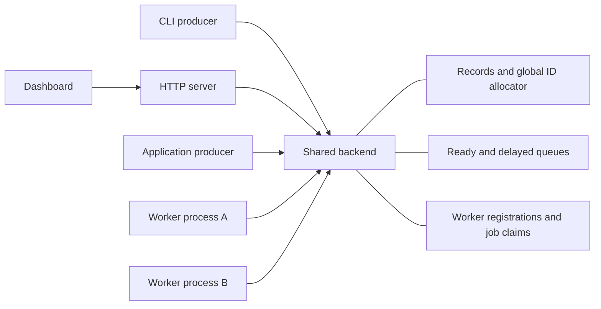
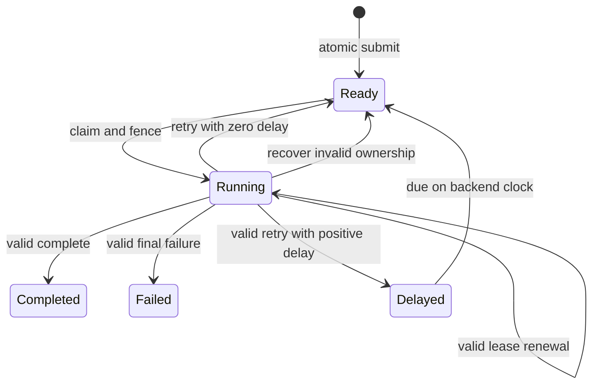

# Distributed backend design

Stage 14.1 defines public C++ contracts for shared processing. Today each
Engine still owns its own JobQueue, JobManager registry, ID allocator,
WorkerPool, and metrics. FileJobStorage appends records under an in-process
mutex and reloads them on startup. Its save/load interface has no distributed
transaction, lock, or queue. Pointing two engines at one journal does not give
them a shared queue and can cause conflicting IDs and writes.

## Target architecture

Future CLI and HTTP server configurations will choose a backend, and
independent worker processes will claim from the same shared scheduler. The
dashboard will see that shared state through HTTP. Redis connectivity,
durable shared storage, and multi-process execution are future increments.
The in-memory fake under `tests/backend` runs only in tests.

## Public contract

Include `jobq/backend/Backend.h`. All results are values. Implementations
must support concurrent calls across clients and preserve the atomicity below
at the boundary of one configured backend namespace. A namespace must never
reuse allocated job IDs or wrap a fencing generation. Application-visible
validation failures must occur before changing coupled structures.

| Operation | Required semantics |
| --- | --- |
| `submit` | Allocate a globally unique ID in the namespace, persist an initial Pending record with zero attempts, and make it ready in one atomic operation. Success returns that ID. |
| `get`, `list` | Return detached records. A missing individual record returns NotFound. List returns retained records and does not mutate them. |
| `registerWorker` | Register a caller-chosen instance ID unique across live processes and workers. An existing live ID conflicts. A replacement registration gets a new opaque token. |
| `heartbeat` | Extend only the matching live worker registration without changing job TTLs. |
| `unregisterWorker` | Remove the matching live registration, immediately invalidating claims owned through that registration. Workers should drain first during graceful shutdown. |
| `claim` | Select the next eligible job, change it to Running, increment its attempt count, and create one exclusive lease atomically. An empty optional means no eligible job. |
| `renew` | Extend only the current live execution claim without updating the record or fencing generation. |
| `complete` | Atomically commit Completed and release the valid claim. |
| `fail` | Atomically release the claim and record final Failed, or move the job to Pending and schedule a retry. A retry beyond the configured limit conflicts. |
| `recoverExpiredClaims` | Requeue Running jobs with invalid or expired ownership, clear their old claims, and return the number moved. Each move is atomic and safe under concurrent recovery. |
| `snapshot` | Return counts exclusive of active claims and worker registration states as of a backend sampling instant. An error denotes an unavailable observation instead of zero counts. |

A job claim contains its ID, worker registration, opaque claim token and
per-job monotonically increasing fencing generation. Every owner operation
checks the relevant token and generation, including the matching worker
registration for a job operation. Registration TTL and job TTL are separate.
Heartbeat does not renew jobs, and job renewal does not extend registration.
If either lease expires, no result or renewal may commit. A revoked or stale
token cannot affect a replacement owner. Detection distinguishes a matching
lease that has expired from superseded ownership.

Ready scheduling is HIGH, NORMAL, then LOW with FIFO within priority using
backend enqueue order. Promote eligible delayed entries before selecting work,
ordered by backend due time and then original delay insertion order. They
join the ready tail within priority. Recovered claims also join the ready
tail, in ascending job ID order within a recovery batch. Recovery preserves
the attempt count, and the next claim increments it. Lease loss is not a
handler retry and can lead to another attempt beyond the handler retry budget.

Durations express positive lease TTLs and nonnegative retry delays. Use an
authoritative backend clock for claim expiry, worker expiry and retry eligibility.
A deadline equal to that clock has expired or is due. Client steady-clock
timestamps are local and must never cross the backend boundary. Implementations
must reject unrepresentable deadlines and counter exhaustion before mutating
state. An adapter must preserve these guarantees under the durability and
failover model it documents.

## Errors and delivery

`Result<T>` contains either the successful value or an explicit error. An
`Outcome` succeeds with `std::monostate`. NotFound denotes a missing record
or registration. OwnershipLost denotes obsolete or mismatched ownership.
LeaseExpired denotes a matching lease beyond its deadline. Conflict denotes
a state or policy conflict. InvalidInput denotes malformed inputs or
invalid durations. Unavailable denotes failed backend access, and Timeout
denotes an exceeded operation deadline. Normal backend failures should not
escape as exceptions.

A transport failure can happen after commit. Timeout or Unavailable is not
an acknowledgement and cannot guarantee rollback of a committed operation.
Callers must reconcile ambiguous results where possible. A blind submission
retry can create a duplicate because this contract does not define a submission
idempotency key. An outage must never trigger fallback to a local queue.

Execution is at least once when recovery makes progress. A handler can apply
an external effect and crash before acknowledging completion. Another worker
can then run the same job. Handlers should make external effects idempotent
or enforce deduplication in the destination system. Fencing protects JobQ
state. External effect protection requires cooperation from the destination.
There is no exactly-once execution guarantee.

## Conformance tests

The reusable `tests/backend/ContractSuite.h` exercises a fresh implementation
through the public interface. The fixture supplies `advance(Duration)` for a
controlled backend clock and `inject(optional<Error>)` for pre-commit fault
injection. Run it with `ctest --test-dir <build> -R jobq_backend_contract
--output-on-failure`. A future Redis-backed harness also needs real
multi-process and durability tests.
