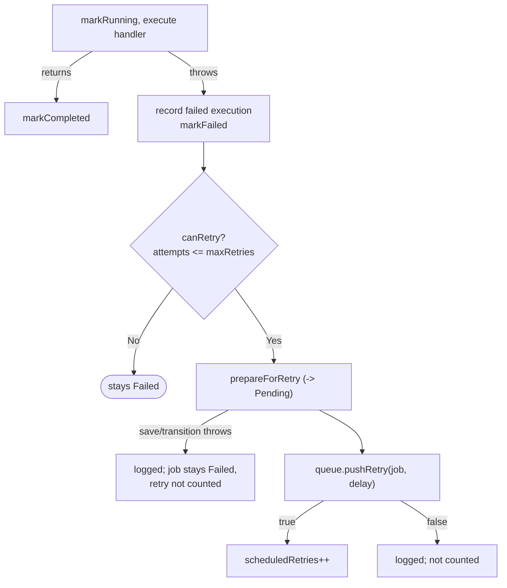

# Fault Tolerance

What JobQ does when components fail, as verified by the Commit 9.5 fault-injection suite: `jobq_fault_injection` (`tests/fault_injection_test.cpp`) plus the earlier 9.x tests. Only behaviour confirmed in the source and a test is listed as verified; gaps are called out.

Test doubles live in `tests/helpers/`:

| Helper | Purpose |
|---|---|
| `FaultInjectingJobStorage.h` | In-memory `JobStorage` that can fail `loadAll()`, or fail any `save()` matching a predicate, and records every successful save. |
| `TemporaryDirectory.h` | Unique temp directory removed on destruction, used for real journal files. |
| `TestSupport.h` | Bounded-wait gate and counter, exception matcher, and the metrics-invariant check. |

No production class has a test-only hook; every fault is injected through the public `JobStorage`, `JobExecutor` and `JobQueue` interfaces or by editing a temporary journal.

---

## 1. Job Execution Failures

- A handler that throws `std::exception` (or anything else, including `throw 7`) fails that **attempt**. The worker records a failed execution, applies the retry policy and keeps running.
- A missing handler (`No handler registered for job type`) is just another failed attempt.
- With `maxRetries = n` a job runs at most `n + 1` times. After the last attempt it stays `Failed`.
- A retryable failure goes `Running -> Failed -> Pending` (two snapshots) and is re-queued through `pushRetry()` with the configured backoff delay. `scheduledRetries` is incremented only after `pushRetry()` returned true.
- A later valid job always runs: tested with one worker, so strict ordering proves the worker survived.

### Job versus execution attempt
One submitted job can produce several attempts. The metrics count different things:

| Counter | Counts |
|---|---|
| `submittedJobs` | Jobs accepted by `JobManager::submit()` (queue accepted it). Retries and recovered jobs do not increment it. |
| `startedExecutions` | Attempts whose `markRunning()` succeeded. |
| `completedExecutions` / `failedExecutions` | Attempt outcomes. A failed attempt is **not** a permanently failed job: it may be retried. |
| `scheduledRetries` | Retries the queue accepted (including recovered retries). |

Example from the suite: 6 jobs, with one flaky (fails once) and one always failing (3 attempts) produce 9 started executions, 3 completed, 6 failed and 3 retries.

---

## 2. Queue Failures

- A closed queue rejects `push()`. `JobManager::submit()` then throws `std::runtime_error`, removes the job from the registry, does not count it, and leaves a durable `Cancelled` record (so recovery will not resurrect it).
- Concurrent submission and closure: every attempt is accepted or rejected; registry, queue size, `submittedJobs` and the durable record counts agree (5 rounds x 400 attempts).
- Retry rejection: `pushRetry()` only returns false for a null job. A closed queue **accepts** retries, so "retry rejected because the queue is closed" cannot occur; instead a retry requested during shutdown is executed (tested: attempts = 2, `scheduledRetries = 1`).
- A late submission during an in-progress shutdown is rejected while the active handler's retry is still honoured.

---

## 3. Storage Failures

Job state changes follow one rule: `Job::transitionTo()` and `prepareForRetry()` call the state observer (the save) **before** changing the in-memory state. If the save throws, the exception propagates and the job stays in its previous state.

| Failure | Result |
|---|---|
| `loadAll()` throws | Persistent `JobManager` construction throws the same error. It is never treated as empty storage. |
| `save()` throws on submit | `submit()` rethrows, the registry entry is removed, nothing is queued, nothing is counted. The next submission gets a fresh unique ID. |
| Recovery cannot save a transition | Construction throws; nothing queued or counted; the durable record is unchanged, so a later recovery with working storage succeeds. |
| Recovery cannot enqueue (closed queue) | `std::runtime_error("Failed to enqueue recovered job N")`; durable state stays `Pending`. |
| Malformed or invalid journal line | `std::runtime_error("Invalid job storage record at line N: ...")`; no job is scheduled; the journal file is not modified. |

### Persistence failures while workers run
These outcomes were observed and are asserted in the tests so they stay documented:

| Injected failure | Observed behaviour |
|---|---|
| Save fails on `Pending -> Running` | The job stays `Pending` in memory and durably. It is **not requeued in this process** (stranded), but the worker keeps processing other jobs and shutdown is safe. A restart recovers it. |
| Save of `Completed` fails once | The attempt is recorded as failed, the job is failed and retried: the handler runs twice. Execution is at-least-once. |
| Save of `Completed` always fails | Retries run out; the job ends `Failed` although the handler succeeded; no completion is counted. |
| Saves of `Completed` and `Failed` both fail | The job stays `Running` in memory. Durable state is `Running`, never a false `Completed`. Restart treats it as interrupted. |
| Save of the retry's `Pending` snapshot fails | No retry is scheduled or counted; the job stays `Failed`. A restart schedules the retry. |

In every case the metrics invariants hold, and memory and disk are never both falsely "Completed". They can disagree, though (for example `Failed` on disk versus a handler that actually succeeded). The persistence layer is not transactional.

---

## 4. Worker Failures

- Unexpected exceptions on the worker thread are caught at the thread boundary and logged with the cause (see [Worker Lifecycle](worker-lifecycle.md)).
- Failures on some workers do not affect the rest (60 jobs, half failing, 4 workers).
- Shutdown while handlers are running and then failing: stop waits, jobs end `Failed` with valid attempt counts.
- Shutdown immediately after a failure does not deadlock.
- Destroying the pool after failures joins every worker.
- Repeated `stop()` after failures is safe.

Not injected: thread-creation failure and partial pool startup. The rollback (close the queue, join started workers, rethrow) is verified by code review only, because causing `std::thread` construction to fail deterministically would need a production-side thread factory.

---

## 5. Corrupted Persistence

All cases use isolated temp journals. Each of the following makes recovery fail at line 2 and leaves valid line 1 unscheduled and the file bytes unchanged: malformed text, a truncated record followed by a newline, an empty line, ID zero, unknown status, unknown priority, multiplier below 1, and attempts exceeding the retry policy.

Handled without error: an empty file (empty store), an unterminated final line (ignored as a torn write), and repeated records for one ID (the latest wins and the job executes once). Duplicate IDs returned by a custom `JobStorage` (not by `FileJobStorage`) are rejected by `JobManager` with `Storage returned duplicate job IDs` (`jobq_recovery_hardening`).

---

## 6. Fault Handling Matrix

| Failure scenario | Expected behaviour | Actual implementation | Regression test |
|---|---|---|---|
| Handler throws | Attempt fails, worker lives | Caught in `processJob`; retry policy applied | `jobq_fault_injection` A |
| Non-standard exception | Same | `catch (...)` path | `jobq_fault_injection` A |
| Retries exhausted | Job stays `Failed` after `1 + maxRetries` attempts | `canRetry()` | `jobq_fault_injection` A, G; `jobq_retry_execution` |
| Storage read failure | Construction fails | `loadAll()` exception propagates | `jobq_fault_injection` B1; `jobq_recovery_hardening` |
| Storage write failure on submit | Submission fails, rollback | Registry erase, rethrow | `jobq_fault_injection` B2 |
| Write failure on `Running` | State unchanged | Observer before state change | `jobq_fault_injection` B3a |
| Write failure on `Completed` | State unchanged, attempt fails | At-least-once retry or `Failed` | `jobq_fault_injection` B3b-d |
| Retry cannot be persisted | Not scheduled, not counted | Exception caught in `handleJobFailure` | `jobq_fault_injection` D |
| Recovery save/enqueue failure | Meaningful error, no side effects | Validate first; error names the job | `jobq_fault_injection` B4; `jobq_recovery_hardening` L |
| Closed queue on submit | Rejected, `Cancelled` record | `push()` false -> `runtime_error` | `jobq_fault_injection` C1 |
| Close racing producers | Exact accept/reject accounting | One mutex | `jobq_fault_injection` C2; `jobq_queue_reliability` J |
| Retry during shutdown | Accepted and executed | `pushRetry()` ignores closure | `jobq_fault_injection` C4; `jobq_worker_shutdown` F |
| Corrupt journal | Fail fast with line number | `FileJobStorage::loadAll()` | `jobq_fault_injection` E; `jobq_recovery_hardening` H |
| Torn final line | Ignored, repaired on next save | `repairIncompleteTailLocked()` | `jobq_file_storage`; `jobq_recovery_hardening` H |
| Failures with many workers | Exact attempt and metrics accounting | Independent per-job state | `jobq_fault_injection` G (5 rounds, 6 workers) |
| Stop during/after failures | No deadlock, valid states | Close then join | `jobq_fault_injection` F |
| Thread creation failure | Rollback, rethrow | `WorkerPool::start()` catch path | **Not tested (code review only)** |
| Allocation failure in queue | No lost retry | Push before pop | **Not tested (code review only)** |
| Cancel record cannot be saved after rejected submit | Original failure reported | Rethrows the save error | **Not tested**; a `Pending` record may remain (see below) |
| Process crash / power loss | Recover from journal | See [Persistence and Recovery](persistence-and-recovery.md) | Simulated by seeding records, not by killing a process |

## 7. Known Gaps

- If the queue rejects a submission **and** the follow-up `Cancelled` save also fails, the durable record stays `Pending` and runs after the next restart although the caller was told the submission failed.
- A job stranded by a failed `Running` save is only picked up again after a restart.
- A job can stay `Running` in memory indefinitely when its outcome cannot be saved.
- No fault in this suite kills the process; real crash behaviour (including OS-level write loss) is not tested.
