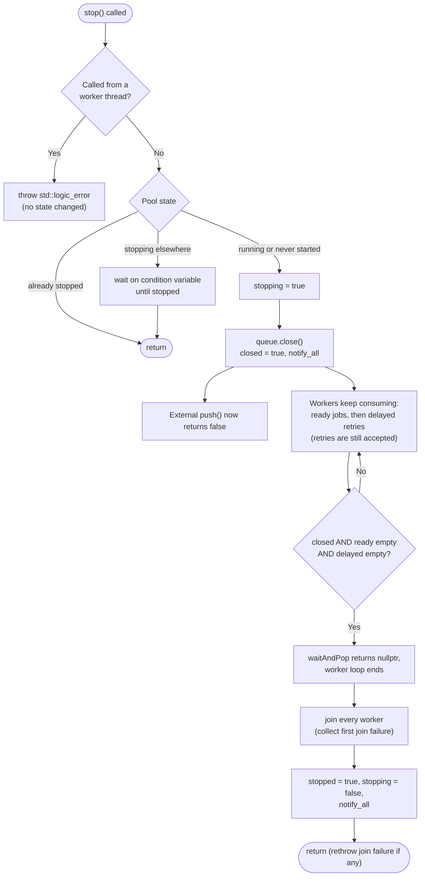

# Graceful Shutdown

This guide describes how `WorkerPool::stop()` shuts JobQ down (Commit 9.1, hardened in 9.2 and 9.3). Everything here reflects the current source and is exercised by `jobq_worker_shutdown` (`tests/worker_shutdown_test.cpp`) unless stated otherwise.

---

## 1. What "Graceful" Means in JobQ

Graceful shutdown is an intentional application operation. JobQ's policy is **close and drain**:

1. Stop accepting new external submissions.
2. Let workers finish every job that was already accepted, including jobs waiting out a retry delay.
3. Join every worker thread.

It is not crash recovery. After an unexpected termination nothing runs `stop()`; see [Persistence and Recovery](persistence-and-recovery.md) for that path.

---

## 2. Shutdown Flow

---

## 3. Behaviour by Scenario

| Scenario | What happens | Accepted work |
|---|---|---|
| Idle pool | Waiting workers wake on `close()` and exit. | Nothing to drain. |
| Jobs queued | Workers execute all of them before exiting. | **Drained.** |
| Job actively running | `stop()` blocks until the handler returns; the job then finishes normally. There is no cancellation or timeout. | Finishes. |
| Handler fails during shutdown | The retry policy applies. `pushRetry()` still accepts retries on a closed queue, so the retry is scheduled and executed. | **Drained**, including the backoff delay. |
| Delayed retry pending | Workers wait until it is due, then run it. `stop()` therefore takes at least as long as the longest pending delay. | **Drained.** |
| New `JobManager::submit()` during/after shutdown | `queue.push()` returns false; `submit()` throws `std::runtime_error` ("...the queue is closed"). The job is removed from the registry, `submittedJobs` is not incremented, and (with storage) a `Cancelled` record is written. | Rejected, not accepted. |
| Pool never started | `stop()` closes the queue and marks the pool stopped. No worker exists, so nothing executes. Jobs already in the queue stay `Pending` in memory; with persistent storage they remain `Pending` on disk and are re-queued by recovery on the next start. | **Retained for recovery**, not drained. |
| Pool destroyed | `~WorkerPool()` calls `stop()` inside a `try/catch`; destructors never throw. | As above. |

Draining requires at least one running worker. With a started pool, the code path guarantees workers only exit when the queue is closed and both heaps are empty (`JobQueue::waitAndPop()`).

---

## 4. Details

### Initiation and the lifecycle lock
`stop()` first checks that it is not running on one of the pool's own worker threads (that would deadlock on join) and throws `std::logic_error` if so. It then takes the pool mutex only long enough to read and set `stopping_`. The queue close and the joins run **outside** the lock so that `isStopped()` and `isStarted()` never block behind a long join.

### Stopping new submissions
`JobQueue::close()` sets `closed_` under the queue mutex and calls `notify_all()`. Any later `push()` returns false. `push()` and `close()` are serialized by the same mutex, so a concurrent submission is either fully accepted before the close or fully rejected. See [Queue Reliability](queue-reliability.md).

### Internal retries during shutdown
`pushRetry()` does not check the closed flag (only null jobs are rejected). This is deliberate: a worker that is still running a job must be able to hand its retry back, and the draining workers will pick it up. A retry is counted in `scheduledRetries` only when `pushRetry()` returned true.

### Worker notification and joining
`close()` wakes all waiting workers. `joinAllWorkers()` joins every worker even if one join throws, remembers the first exception, finishes the state update, and then rethrows it.

### Repeated and concurrent calls
- Second and later `stop()` calls return immediately once the pool is stopped.
- A call that arrives while another thread is stopping waits on a condition variable until the first finishes. Threads are never joined twice.
- `start()` after `stop()` (even a stop on a never-started pool) throws `std::logic_error("Worker pool cannot be restarted")`.

### Shutdown before startup
Verified by test E in `worker_shutdown_test.cpp`: an unstarted pool reports not started and not stopped; after `stop()` it reports stopped but still not started; repeated `stop()` and destruction are safe.

---

## 5. Limitations

- `stop()` has no timeout. A handler that never returns blocks shutdown forever.
- A long retry backoff delays shutdown by the same amount.
- Jobs in a never-started pool are retained, not executed, by design.
- Graceful shutdown does not flush the journal to disk (`FileJobStorage` has no `fsync`).

See also [Worker Lifecycle](worker-lifecycle.md) and [Troubleshooting](troubleshooting.md#worker-shutdown-appears-blocked).
