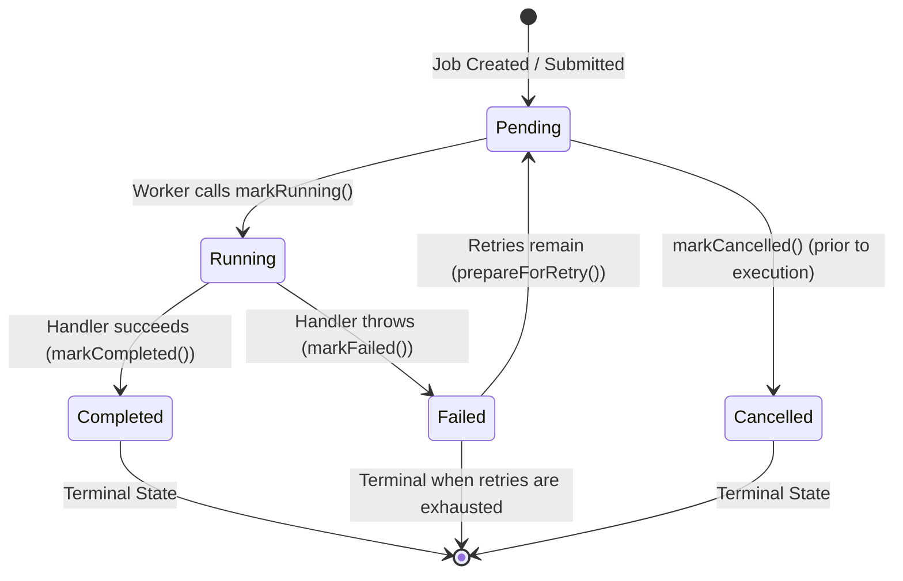

# Job Lifecycle & State Transitions

This document defines the lifecycle states, transition rules, attempt tracking, and validation invariants of a `Job` in JobQ.

---

## 1. Lifecycle State Machine

A job progresses through a defined finite state machine. All transitions are validated at runtime; attempting an invalid transition throws a `std::logic_error`.



---

## 2. Job Statuses (`JobStatus`)

The `JobStatus` enum class is defined in [`include/job/Job.h`](../include/job/Job.h):

```cpp
enum class JobStatus {
    Pending,
    Running,
    Completed,
    Failed,
    Cancelled
};
```

| Status | Description | Is Terminal? |
|---|---|---|
| `Pending` | The job is waiting in the `JobQueue` to be consumed by an available worker. | No |
| `Running` | A worker thread has popped the job and is actively executing its registered handler. | No |
| `Completed` | The registered handler executed to completion without throwing any exceptions. | **Yes** |
| `Failed` | The handler threw an exception and the job has exhausted its configured `RetryPolicy`. | **Yes** |
| `Cancelled` | The job was cancelled before execution began. | **Yes** |

---

## 3. Transition Rules & Invariants

All status transitions are protected by `Job::statusMutex_` and enforced by `Job::transitionTo()`:

```cpp
void Job::transitionTo(JobStatus expectedCurrent, JobStatus newStatus) {
    std::lock_guard<std::mutex> lock(statusMutex_);
    if (status_ != expectedCurrent) {
        throw std::logic_error("Invalid job state transition");
    }
    status_ = newStatus;
    notifyObserverLocked();
}
```

### Allowed Transitions

1. **`Pending -> Running` (`markRunning()`):**
   - Invoked exclusively by a `Worker` immediately after popping a job from `JobQueue`.
2. **`Running -> Completed` (`markCompleted()`):**
   - Invoked by the worker when the handler returns normally.
3. **`Running -> Failed` (`markFailed()`):**
   - Invoked whenever a handler throws, regardless of the retry policy. `attemptsMade_` was already incremented by `markRunning()`.
4. **`Failed -> Pending` (`prepareForRetry()`):**
   - Invoked afterwards when `canRetry() == true` (`attemptsMade_ <= maxRetries`). It does not change the attempt count; it only resets `status_` to `Pending` before the job is re-queued with `pushRetry()`.
   - If `canRetry() == false` the job simply stays `Failed`.
   - Every transition calls the state observer (the persistence save) *before* the in-memory state changes, so a failing save leaves the job in its previous state.
5. **`Pending -> Cancelled` (`markCancelled()`):**
   - Invoked if a job is cancelled before a worker claims it.

### Illegal Transitions
Any attempt to transition from a terminal state (`Completed`, `Failed`, `Cancelled`) or from `Pending` directly to `Completed` throws `std::logic_error`. Terminal states are immutable.

---

## 4. Job Identity and Attributes

Each job is constructed with the following core properties:

```cpp
class Job {
    uint64_t id_;
    std::string type_;
    std::string payload_;
    JobPriority priority_;
    RetryPolicy retryPolicy_;
    std::size_t attemptsMade_{0};
    mutable std::mutex statusMutex_;
    JobStatus status_;
    JobStateObserver stateObserver_;
};
```

### 1. Job ID (`uint64_t`)
- Assigned monotonically by `JobManager::nextId_` (`std::atomic<uint64_t>`).
- Persistent and preserved across application crashes and restarts.

### 2. Job Type (`std::string`)
- An application-defined identifier (e.g. `"EMAIL"`, `"REPORT"`, `"IMAGE_RESIZE"`).
- Used by `JobExecutor` to route the job to its registered handler.

### 3. Payload (`std::string`)
- Arbitrary text, JSON, or serialized data needed by the handler to execute the task.

### 4. Job Priority (`JobPriority`)
- Enum defining scheduling urgency:
  - `JobPriority::Low` (`0`)
  - `JobPriority::Normal` (`1`) — Default
  - `JobPriority::High` (`2`)
- Higher numerical priorities are scheduled before lower ones. Equal priorities follow strict FIFO order.

### 5. Attempt Tracking (`attemptsMade_`)
- Tracks how many execution attempts have been made.
- Starts at `0`.
- Incremented when `markRunning()` succeeds (that is, when an attempt starts), not by `prepareForRetry()`.
- Persisted to disk with each snapshot.

---

## 5. Job Snapshots & Observer Notifications

To decouple persistence and metrics from the internal mutex of `Job`, JobQ uses immutable `JobSnapshot` structures:

```cpp
struct JobSnapshot {
    uint64_t id;
    std::string type;
    std::string payload;
    JobPriority priority;
    JobStatus status;
    RetryPolicy retryPolicy;
    std::size_t attemptsMade;
};
```

Calling `job->snapshot()` acquires `statusMutex_` and returns a copy of the state.

When `JobManager` creates a job, it attaches a `JobStateObserver`:
```cpp
using JobStateObserver = std::function<void(const JobSnapshot&)>;
```
Whenever `transitionTo()` or `prepareForRetry()` changes the state, the observer is invoked, automatically triggering persistence to `JobStorage`.
