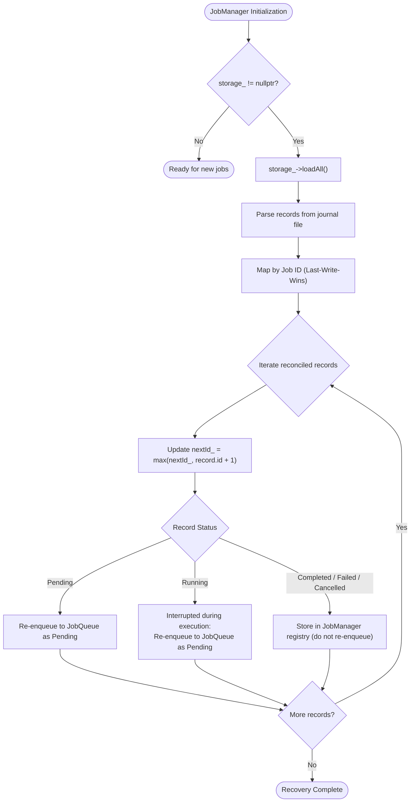

# Persistence & Crash Recovery

JobQ includes an append-only file journal persistence layer that allows jobs to survive unexpected application terminations, crashes, and restarts.

---

## 1. Storage Architecture

The persistence model consists of:
1. **`JobRecord`**: A flat data-transfer structure representing a persistent snapshot.
2. **`JobStorage`**: An abstract interface defining basic storage primitives.
3. **`FileJobStorage`**: An append-only journal file implementation.
4. **`JobManager`**: Coordinates automatic snapshot persistence on state transitions and performs startup recovery.

```mermaid
flowchart LR
    subgraph InProcess ["In-Memory Job Lifecycle"]
        J["Job"] -->|Status change| Obs["JobStateObserver"]
        Obs -->|Pass JobSnapshot| JM["JobManager"]
    end

    subgraph DiskStorage ["Disk Journal (data/jobs.journal)"]
        JM -->|save(JobRecord)| FJS["FileJobStorage"]
        FJS -->|Append serialized line| File[("Journal File")]
    end

    subgraph RestartRecovery ["Application Restart"]
        File -->|loadAll()| FJS
        FJS -->|repairIncompleteTail| FJS
        FJS -->|Return historical records| JM
        JM -->|Reconcile & Re-enqueue| JQ["JobQueue"]
    end
```

---

## 2. The Journal Format (`JobRecord`)

The `JobRecord` structure represents a serialized snapshot:

```cpp
struct JobRecord {
    uint64_t id{0};
    std::string type;
    std::string payload;
    JobPriority priority{JobPriority::Normal};
    JobStatus status{JobStatus::Pending};
    RetryPolicy retryPolicy{};
    std::size_t attemptsMade{0};
};
```

### Delimited Text Record Serialization
Each state change is appended to the journal as a single line:

```text
RECORD|id=1|type=REPORT|priority=1|status=0|max_retries=2|initial_delay_ms=100|multiplier=2.000000|max_delay_ms=5000|attempts=0|payload=demo-data
RECORD|id=1|type=REPORT|priority=1|status=1|max_retries=2|initial_delay_ms=100|multiplier=2.000000|max_delay_ms=5000|attempts=0|payload=demo-data
RECORD|id=1|type=REPORT|priority=1|status=2|max_retries=2|initial_delay_ms=100|multiplier=2.000000|max_delay_ms=5000|attempts=0|payload=demo-data
```

- Status integer encodings: `0 = Pending`, `1 = Running`, `2 = Completed`, `3 = Failed`, `4 = Cancelled`.
- Newlines and delimiter characters inside payloads are properly escaped and unescaped.

---

## 3. Automatic Snapshot Persistence

When `JobManager` creates a job with a configured `JobStorage`, it injects a `JobStateObserver`:

```cpp
JobStateObserver JobManager::createStateObserver() const {
    if (!storage_) {
        return {};
    }
    return [this](const JobSnapshot& snapshot) {
        persistSnapshot(snapshot);
    };
}
```

Whenever any of the following transitions occur:
- `JobManager::submit()` -> initial state: `Pending`
- `Worker` claims job -> state: `Running`
- `Worker` finishes handler -> state: `Completed`
- Handler failure with retries -> `prepareForRetry()` resets state to `Pending` with incremented `attemptsMade`
- Handler failure with exhausted retries -> state: `Failed`

The observer immediately writes an updated `JobRecord` to the journal file.

---

## 4. Startup Recovery Pipeline

When `JobManager` starts up with an existing journal file, it automatically calls `restoreStoredJobs()`:



### Recovery Rules
1. **Last-Write-Wins Reconciliation:** The journal is read sequentially. Newer records for the same Job ID overwrite older records, reflecting the most recent state.
2. **Next ID Alignment:** `nextId_` is set to `max(restoredIds) + 1` so newly submitted jobs never collide with restored IDs.
3. **Resuming Interrupted Jobs:** If the application crashed while a job was in the `Running` state, it is safely re-enqueued as `Pending` so that a worker can resume processing it.
4. **Terminal Jobs:** Jobs in `Completed`, `Failed`, or `Cancelled` states are registered in the in-memory lookup table (`getJob()`, `getStatus()`) but are **not** re-enqueued.

---

## 5. Crash Resilience: Incomplete Tail Truncation

A common failure mode in append-only storage is a power failure or process kill midway through writing a line to disk.

`FileJobStorage` guards against this in `repairIncompleteTailLocked()`:
1. When opening the journal file, it scans backwards from the end of the file.
2. If the final character is not a newline (`\n`), the last line was truncated during a crash.
3. The file is cleanly truncated to the end of the last complete newline.
4. Subsequent appends proceed normally without data corruption.

---

## 6. Boundaries and Limitations

- **Single Host / Local File:** `FileJobStorage` is designed for single-node in-process execution. It does not support concurrent write access from multiple separate operating system processes.
- **Append-Only Journal:** The journal is purely append-based; journal compaction (vacuuming historical state lines into snapshot checkpoints) is a planned enhancement.
- **Not an ACID Database:** While durable and crash-resilient against partial line writes, it does not provide multi-table transactions or distributed replication.
