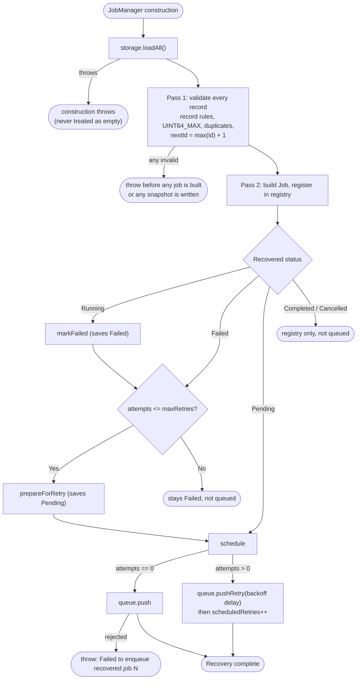

# Persistence & Crash Recovery

JobQ includes an append-only file journal persistence layer that allows jobs to survive unexpected application terminations, crashes, and restarts.

---

## 1. Storage Architecture

The persistence model consists of:
1. **`JobRecord`**: A flat data-transfer structure representing a persistent snapshot.
2. **`JobStorage`**: An abstract interface defining basic storage primitives.
3. **`FileJobStorage`**: An append-only journal file implementation.
4. **`JobManager`**: Coordinates automatic snapshot persistence on state transitions and performs startup recovery.

```mermaid
flowchart LR
    subgraph InProcess ["In-Memory Job Lifecycle"]
        J["Job"] -->|Status change| Obs["JobStateObserver"]
        Obs -->|Pass JobSnapshot| JM["JobManager"]
    end

    subgraph DiskStorage ["Disk Journal (data/jobs.journal)"]
        JM -->|save(JobRecord)| FJS["FileJobStorage"]
        FJS -->|Append serialized line| File[("Journal File")]
    end

    subgraph RestartRecovery ["Application Restart"]
        File -->|loadAll()| FJS
        FJS -->|Return historical records| JM
        JM -->|Reconcile & Re-enqueue| JQ["JobQueue"]
    end
```

---

## 2. The Journal Format (`JobRecord`)

The `JobRecord` structure represents a serialized snapshot:

```cpp
struct JobRecord {
    uint64_t id{0};
    std::string type;
    std::string payload;
    JobPriority priority{JobPriority::Normal};
    JobStatus status{JobStatus::Pending};
    RetryPolicy retryPolicy{};
    std::size_t attemptsMade{0};
};
```

### Delimited Text Record Serialization
Each state change is appended to the journal as a single line with 11 `|`-separated fields. Type and payload are hex-encoded, so delimiters and newlines inside them cannot corrupt the line:

```text
JOBQ1|id|STATUS|PRIORITY|attemptsMade|maxRetries|initialDelayMs|multiplier|maxDelayMs|hex(type)|hex(payload)
JOBQ1|1|PENDING|NORMAL|0|2|100|2|5000|5245504F5254|64656D6F2D64617461
JOBQ1|1|RUNNING|NORMAL|1|2|100|2|5000|5245504F5254|64656D6F2D64617461
JOBQ1|1|COMPLETED|NORMAL|1|2|100|2|5000|5245504F5254|64656D6F2D64617461
```

- Status values: `PENDING`, `RUNNING`, `COMPLETED`, `FAILED`, `CANCELLED`. Priorities: `LOW`, `NORMAL`, `HIGH`. Anything else is rejected, never mapped to a default.
- `validateJobRecord()` runs on both serialize and deserialize and rejects: ID zero; unknown status or priority; negative delays; a multiplier that is not finite or is below 1.0; a `Running`/`Completed`/`Failed` record with zero attempts; and attempt counts that exceed the retry policy (`Pending`/`Cancelled`: attempts above `maxRetries`; other states: attempts above `maxRetries + 1`).

---

## 3. Automatic Snapshot Persistence

When `JobManager` creates a job with a configured `JobStorage`, it injects a `JobStateObserver` that calls `storage->save()` with the snapshot of the **new** state. `Job` invokes the observer *before* it changes its in-memory state, so:

- if `save()` throws, the transition does not happen and the exception propagates to the caller;
- the durable record is therefore never behind a state that was only applied in memory.

Persisted transitions:
- `JobManager::submit()` -> `Pending` (a rejected enqueue then writes `Cancelled`).
- Worker claims a job -> `Running` (the snapshot already carries the incremented `attemptsMade`).
- Handler returns -> `Completed`.
- Handler throws -> `Failed`; if retries remain, `prepareForRetry()` then writes `Pending` with the same `attemptsMade`.

Persistence is not transactional: the save and the in-memory change are two steps. See [Fault Tolerance](fault-tolerance.md) for what the suite verifies when a save fails.

---

## 4. Startup Recovery Pipeline

When a persistent `JobManager` is constructed it calls `restoreStoredJobs()`:



### Recovery Rules
1. **Latest record wins:** `FileJobStorage::loadAll()` collapses repeated lines for one ID to the latest record, keeping the position of its first appearance. A job's history is therefore one record.
2. **Validate first:** every record is validated before any job is created, so a bad record can never cause partial recovery or journal writes.
3. **Next ID:** `nextId_ = max(restored IDs) + 1`, independent of record order or gaps. Empty storage starts at 1. A record with ID `UINT64_MAX` is rejected (`std::overflow_error`).
4. **Interrupted `Running` jobs** are failed (a failed attempt, attempts not reset) and retried when `attemptsMade <= maxRetries`; otherwise they stay `Failed`.
5. **Retry delay** is recomputed from the attempt count and starts at recovery time.
6. **Terminal jobs** (`Completed`, `Cancelled`, exhausted `Failed`) are registered for `getJob()` / `getStatus()` but not queued.
7. **No metrics side effects:** restored jobs do not increase `submittedJobs`; recovered retries do increase `scheduledRetries` once the queue accepted them.

---

## 5. Crash Resilience: Incomplete Tail Handling

A power failure or process kill can leave a half-written final line.

- `loadAll()` ignores a final line that has no trailing newline.
- `save()` calls `repairIncompleteTailLocked()` first: if the last byte is not a newline, the file is truncated back to the last complete line before appending.
- A malformed line **with** a newline is not a torn write; it is reported as corruption (`Invalid job storage record at line N`).

A record that was fully written but not yet newline-terminated at the moment of the crash is indistinguishable from a torn line and is dropped.

---

## 6. Boundaries and Limitations

- **Single host, single process:** `FileJobStorage` uses an in-process mutex. There is no OS file lock, so concurrent writers from separate processes are unsupported.
- **No durable flush:** records are flushed to the OS, not `fsync`ed. An OS crash or power loss can lose recent records.
- **No atomic replacement:** the journal is append-only; nothing is rewritten except tail truncation.
- **Append-only growth:** compaction is a planned enhancement.
- **Not an ACID database:** there are no transactions, and in-memory and durable state can disagree after a failed save.
- **At-least-once execution:** see below.

---

## 7. Operational Behaviour After a Restart

This section describes what an operator will observe. For failure cases see [Troubleshooting](troubleshooting.md).

| Journal state of a job | After restart |
|---|---|
| `Pending`, no attempts | Registered and pushed to the queue. Runs as a normal job. |
| `Pending` with attempts (a scheduled retry) | Registered and pushed as a delayed retry; `scheduledRetries` counts it. |
| `Running` (process died mid-execution) | Counted as a failed attempt; retried if `attemptsMade <= maxRetries`, otherwise `Failed`. Two records are appended (`Failed`, then `Pending`). |
| `Failed` with retries left (for example a retry that could not be saved) | Prepared for retry and scheduled. |
| `Failed`, retries exhausted | Stays `Failed`; not queued. |
| `Completed` | Registered, not queued, not counted anywhere. |
| `Cancelled` (including submissions rejected by a closed queue) | Registered, not queued. |

**Corrupted records:** recovery fails with the line number and changes nothing (fail-fast policy; corrupt records are never silently skipped). Only an unterminated final line is tolerated.

**Storage cannot be read:** construction throws. **Storage cannot be written** during recovery (needed for interrupted jobs): construction throws and the journal is unchanged for that job. **Queue closed:** `Failed to enqueue recovered job N`.

**At-least-once, not exactly-once.** If the process dies after a handler returns but before the `Completed` record is written, the durable state is `Running`; after restart the job is treated as interrupted and its handler can run again, or the job ends `Failed` if no retries remain even though the earlier run succeeded. A failed save of `Completed` has the same effect without a crash. Handlers should be idempotent.

**Graceful shutdown versus crash recovery.** A graceful `stop()` drains accepted work before exit (see [Graceful Shutdown](graceful-shutdown.md)); recovery handles whatever an unexpected termination (or a never-started pool) left behind. They are separate mechanisms.

**Job recovery versus metrics.** Jobs are recovered from the journal; `JobMetrics` is not. Counters start at zero in each process, are never persisted, and recovered history does not count as submissions or executions.
