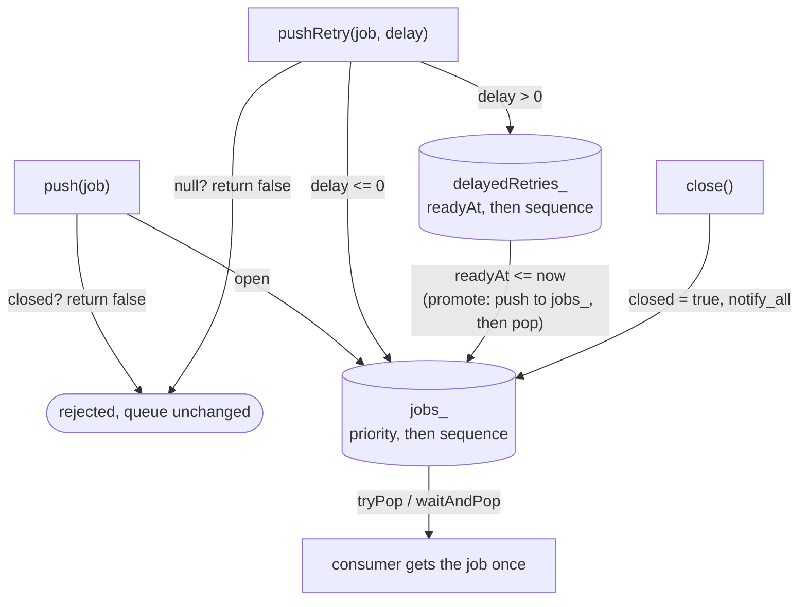

# Queue Reliability

How `JobQueue` behaves under concurrent access, closure, priority scheduling and delayed retries (Commit 9.3). Verified by `jobq_queue_reliability` (`tests/job_queue_reliability_test.cpp`), `jobq_priority_scheduling` and `jobq_retry_backoff`. For the broader scheduling design see [Queue and Workers](queue-and-workers.md).

---

## 1. Synchronization Model

`JobQueue` uses one `std::mutex` and one `std::condition_variable`. The mutex protects **all** shared state:

- `jobs_` - the ready priority heap.
- `delayedRetries_` - the delayed min-heap ordered by ready time.
- `nextSequence_` - the sequence counter.
- `closed_` - the closure flag.

Every public method (`push`, `pushRetry`, `tryPop`, `waitAndPop`, `close`, `isClosed`, `empty`, `size`) takes the mutex, so each is atomic with respect to the others. There are no atomics or lock-free structures, and no lock is held across anything that blocks except the condition-variable wait itself.

---

## 2. Entries: Immediate, Delayed and Promoted

| Kind | Where it lives | How it gets there |
|---|---|---|
| Immediate | `jobs_` | `push()`, or `pushRetry()` with a delay of zero or less. |
| Delayed retry | `delayedRetries_` | `pushRetry()` with a positive delay; `readyAt = steady_clock::now() + delay`. |
| Promoted retry | `jobs_` | `promoteDueRetriesLocked()` moves entries whose `readyAt` has passed; it runs at the start of every `tryPop()` and every wake-up in `waitAndPop()`. |

`size()` and `empty()` count **both** heaps. A job waiting for its retry delay is counted, is not returned by `tryPop()`, and means the queue is not empty.

---

## 3. Ordering

- **Priority:** `High` before `Normal` before `Low` (the numeric value of `JobPriority`). The comparator reads `job->getPriority()`, which is a fixed member and needs no lock.
- **FIFO within a priority:** each entry gets `nextSequence_++` under the mutex; lower sequence pops first. Verified with 50 equal-priority jobs and mixed priorities.
- **Delayed entries:** ordered by `readyAt`, ties broken by sequence.
- **Promotion:** a due retry is pushed into `jobs_` with a **new** sequence number, so it competes by priority and queues *behind* same-priority jobs that were already ready. Several due retries are promoted in `readyAt` order.

No fairness between consumer threads is promised: whichever waiting thread gets the lock first takes the next job.

---

## 4. Consumers and Notifications

`waitAndPop()` loops under the lock:

1. Promote due retries.
2. If `jobs_` is not empty, pop and return the top job.
3. If the queue is closed and `delayedRetries_` is empty, return `nullptr`.
4. If `delayedRetries_` is not empty, `wait_until` the earliest `readyAt`; otherwise `wait`.

Because the state is re-evaluated after every wake-up, spurious wake-ups are harmless. Notifications:

| Event | Notification |
|---|---|
| `push()` | `notify_one()` |
| `pushRetry()` | `notify_all()` (the earliest wake-up time may have changed for sleeping consumers) |
| `close()` | `notify_all()` |

Verified: a consumer sleeping for a 5 s retry wakes for a 50 ms retry pushed later; an immediate job is returned without waiting for a future retry; four blocked consumers all wake on `close()`.

### Exception safety of promotion
`promoteDueRetriesLocked()` pushes the entry into `jobs_` **before** popping it from `delayedRetries_`. If the push throws (for example `std::bad_alloc`) the retry is still in the delayed heap, so an accepted retry is never lost. This was the one defect found in the 9.3 audit. It cannot be triggered deterministically from a test; the fix is verified by code review.

---

## 5. Closure and Concurrent Push

| Call | While open | After `close()` |
|---|---|---|
| `push(job)` | Accepted, returns true | Returns false; nothing inserted |
| `push(nullptr)` | false | false |
| `pushRetry(job, delay)` | Accepted | **Still accepted** (internal retries must drain) |
| `pushRetry(nullptr, ...)` | false | false |
| `tryPop()` / `waitAndPop()` | Normal | Keep returning jobs, including due and delayed retries; `waitAndPop()` returns `nullptr` only when both heaps are empty |
| `close()` | Sets flag | Idempotent |

**Concurrent submission and closure.** `push()` checks `closed_` and inserts under the same lock that `close()` takes to set it. Therefore each `push()` is atomically accepted (it ran before the close) or rejected (after). The return value is exact; callers must not check `isClosed()` first. Test J runs 4 producers against a closer thread for 20 rounds and checks: accepted + rejected = attempted, queue size = accepted, and every accepted job is retrievable.

`JobManager::submit()` builds on this: a rejected push becomes a thrown `std::runtime_error`, a registry rollback and a durable `Cancelled` record (see [Fault Tolerance](fault-tolerance.md)).

---

## 6. Test Map

| Behaviour | Test (in `job_queue_reliability_test.cpp` unless noted) |
|---|---|
| 4 producers x 250 jobs, no loss or duplicates | A |
| Multiple consumers, each job once | B |
| Producers and consumers together: accepted = consumed + remaining | C |
| Push after close rejected, contents unchanged | D |
| Repeated `close()` | E |
| Waiters woken by close | F |
| Priority and FIFO | G (also `job_priority_test.cpp`) |
| Delayed retry timing and promotion order | H (also `job_retry_backoff_test.cpp`) |
| Immediate jobs versus future retries; earlier retry re-targets sleepers | I |
| Push racing close | J |
| `empty()` / `size()` / `isClosed()` states and concurrent observers | K |

## 7. Limitations

- The delayed-retry tests use real 100-200 ms delays; they are timing-based by nature.
- A retry accepted after every consumer has exited is never consumed. In practice a running worker always drains before it exits, so this does not occur through `WorkerPool`.
- `size()` and `empty()` are instantaneous snapshots; they can be stale by the time the caller acts.
