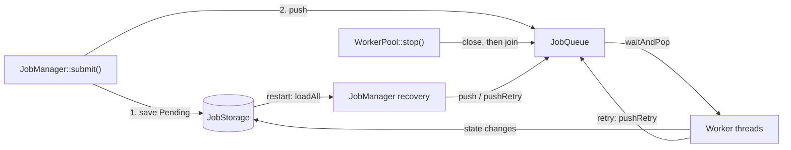

# Reliability Guide

This is the entry point for JobQ's reliability documentation (Phase 9). It describes what the code actually does today, what the automated tests verify, and what JobQ deliberately does **not** guarantee.

> JobQ is a single-process, single-host job engine with a file journal. It is not a distributed system and does not provide exactly-once execution. See [Known Limitations](#5-known-limitations).

---

## 1. Overview

A job-processing engine accepts work on behalf of callers, so the important question is not "does it run jobs?" but "what happens to accepted jobs when something goes wrong?" Phase 9 hardened five areas and then verified them with injected failures:

| Commit | Area | Result |
|---|---|---|
| 9.1 | Graceful shutdown | `WorkerPool::stop()` closes the queue and drains accepted work before joining workers. |
| 9.2 | Worker lifecycle | Single-use `Worker`, safe join/destroy, exception boundary, rollback on partial pool startup. |
| 9.3 | Queue reliability | Atomic push-versus-close, exception-safe retry promotion, verified concurrent behaviour. |
| 9.4 | Persistence and recovery | Validate-everything-first recovery, record-level attempt validation, meaningful recovery errors. |
| 9.5 | Fault injection | Tests that deliberately fail storage, handlers, queue and workers. |

These pieces interact in one chain:

- Submission persists first, then enqueues. A rejected enqueue produces a durable `Cancelled` record.
- Workers persist every state change before applying it in memory.
- Shutdown closes the queue; workers keep consuming until the queue (including delayed retries) is empty.
- After a crash or restart, recovery rebuilds the registry and queue from the journal.

---

## 2. Reliability Components

| Component | Files | Reliability role |
|---|---|---|
| `Job` | `include/job/Job.h`, `src/job/Job.cpp` | State machine. The state observer is called **before** the in-memory state changes, so a failing save leaves the job in its previous state. |
| `JobQueue` | `include/queue/JobQueue.h`, `src/queue/JobQueue.cpp` | One mutex and one condition variable guard the ready heap, the delayed-retry heap, the sequence counter and the closed flag. |
| `Worker` | `include/worker/Worker.h`, `src/worker/Worker.cpp` | Owns one thread; single-use lifecycle; exception boundary around the thread entry point. |
| `WorkerPool` | `include/worker/WorkerPool.h`, `src/worker/WorkerPool.cpp` | Serialized start/stop, idempotent shutdown, rollback on partial startup. |
| `JobManager` | `include/manager/JobManager.h`, `src/manager/JobManager.cpp` | Submission with rollback, startup recovery, next-ID calculation. |
| `JobStorage` | `include/storage/JobStorage.h` | Two-method interface (`save`, `loadAll`). Both may throw. |
| `JobRecord` | `include/storage/JobRecord.h`, `src/storage/JobRecord.cpp` | Serialization and `validateJobRecord()`. |
| `FileJobStorage` | `src/storage/FileJobStorage.cpp` | Append-only journal with torn-tail repair. |
| `JobMetrics` | `include/metrics/JobMetrics.h` | Process-local counters; see [Metrics](metrics-and-observability.md). |

Detailed behaviour lives in the dedicated guides:
[Graceful Shutdown](graceful-shutdown.md), [Worker Lifecycle](worker-lifecycle.md), [Queue Reliability](queue-reliability.md), [Fault Tolerance](fault-tolerance.md) and [Persistence and Recovery](persistence-and-recovery.md).

---

## 3. Reliability Guarantees

"Verification" names the CTest test (source file in parentheses). Every test listed is registered in `CMakeLists.txt`.

| Area | Behaviour (as implemented) | Verification |
|---|---|---|
| Shutdown | `stop()` closes the queue, then joins workers. Workers drain every accepted ready job and every delayed retry before exiting. `stop()` blocks until running handlers return. New external submissions are rejected. | `jobq_worker_shutdown` (`worker_shutdown_test.cpp`) |
| Shutdown idempotency | Repeated and concurrent `stop()` calls are safe; later calls wait for the first. Destructor calls `stop()`. | `jobq_worker_shutdown`, `jobq_worker_lifecycle` |
| Worker lifecycle | `Worker` is Created -> Running -> Joined and cannot be restarted. `start()` twice throws; `join()` is idempotent; self-join throws. The destructor never lets a joinable `std::thread` be destroyed. | `jobq_worker_lifecycle` (`worker_lifecycle_test.cpp`) |
| Pool lifecycle | A pool is single-use. `start()` after `stop()` or a second `start()` throws `std::logic_error`. Failed partial startup closes the queue, joins started workers and rethrows. | `jobq_worker_lifecycle` (rollback is reviewed, not injected; see [Fault Tolerance](fault-tolerance.md)) |
| Queue concurrency | All queue state is protected by one mutex. A `push()` is accepted if and only if it acquires the lock before `close()`. Each accepted job is consumed exactly once. | `jobq_queue_reliability` (`job_queue_reliability_test.cpp`) |
| Ordering | Higher priority first; FIFO within a priority; due retries re-enter the ready heap with a fresh sequence number. | `jobq_queue_reliability`, `jobq_priority_scheduling` |
| Retry handling | A job runs at most `1 + maxRetries` times. A retry is counted as scheduled only after the queue accepted it. Retries requested during shutdown are accepted and executed. | `jobq_retry_execution`, `jobq_retry_backoff`, `jobq_worker_shutdown`, `jobq_fault_injection` |
| Worker survival | Handler exceptions (standard or not) fail the attempt; the worker keeps running. | `jobq_fault_injection` (`fault_injection_test.cpp`) |
| Persistence | Each state change is appended as one validated line. Torn tails are ignored on load and truncated on the next save. Write errors propagate to the caller. A failed save leaves the previous in-memory state. | `jobq_file_storage`, `jobq_storage_record`, `jobq_recovery_hardening`, `jobq_fault_injection` |
| Recovery | All records are validated before any job is rebuilt or any snapshot is written. Interrupted `Running` jobs are failed, then retried if the policy allows. Completed, cancelled and exhausted jobs are restored but not queued. Next ID is `max(id) + 1`. | `jobq_crash_recovery`, `jobq_persistence_recovery_regression`, `jobq_recovery_hardening` (`job_recovery_hardening_test.cpp`) |
| Metrics under faults | `finished == completed + failed`, `started == finished` once work drains, `scheduledRetries <= failed`, rejected submissions are never counted. | `jobq_fault_injection`, `jobq_metrics_integration` |

---

## 4. Verified Behaviour Versus Guarantee

A passing test shows behaviour in the scenarios it exercises. The guarantees above are the ones the source code enforces *and* a test exercises. Where something is true by code review only, the relevant guide says so (for example thread-creation failure during pool startup).

Planned, not implemented: journal compaction, daemon mode with signal handling, handler timeouts, distributed coordination. See the [Roadmap](roadmap.md).

---

## 5. Known Limitations

These were checked against the source:

| Limitation | Detail |
|---|---|
| Process-local queue | `JobQueue` lives in memory in one process. Nothing coordinates two processes. |
| File persistence without OS locking | `FileJobStorage` serializes writes with an in-process mutex only. There is no file lock; two processes writing one journal can interleave records. |
| No durable flush | `save()` flushes the stream but does not call `fsync`. An OS crash or power loss can lose recently written records. |
| No atomic replacement | The journal is append-only. The only rewrite is truncating an unterminated final line. Nothing relies on atomic rename. |
| At-least-once, not exactly-once | A crash after a handler succeeds but before the `Completed` record is written leaves a durable `Running` record; recovery will treat it as interrupted. Handlers must be idempotent. |
| Persistence is not transactional | In-memory state and durable state are updated in two steps. If a save fails, the job is not advanced, and it can be stranded in this process (see [Fault Tolerance](fault-tolerance.md)). |
| Shutdown waits for handlers | There is no handler timeout or cancellation; `stop()` blocks until every running handler returns. |
| Shutdown waits for delayed retries | Pending backoff delays are honoured during shutdown, so `stop()` can take as long as the longest pending delay. |
| No metrics persistence | `JobMetrics` is process-local and starts at zero after restart. |
| Unbounded journal | Every state change appends a line; there is no compaction. |
| Lifecycle calls from workers | Calling `WorkerPool::stop()` from a handler throws; `Worker::join()` from its own thread throws. |

---

## 6. Related Documentation

- [Graceful Shutdown](graceful-shutdown.md)
- [Worker Lifecycle](worker-lifecycle.md)
- [Queue Reliability](queue-reliability.md)
- [Fault Tolerance](fault-tolerance.md)
- [Persistence and Recovery](persistence-and-recovery.md)
- [Troubleshooting](troubleshooting.md)
- [Testing Guide](testing.md)
- [Job Lifecycle](job-lifecycle.md), [Retry System](retry-system.md), [Metrics](metrics-and-observability.md)
