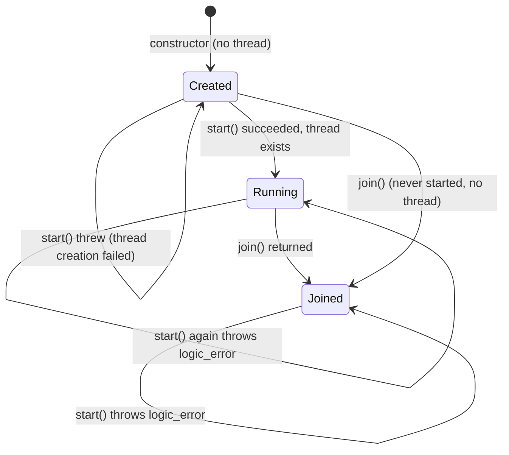
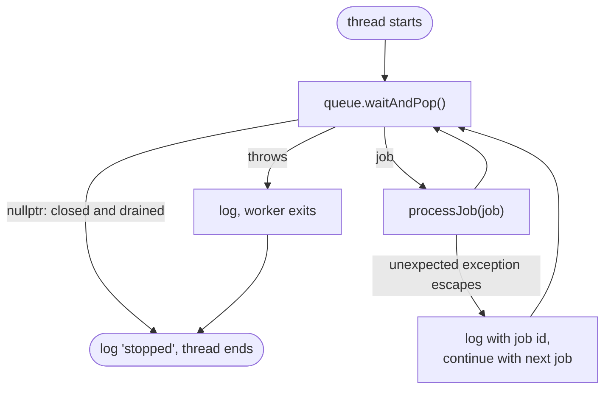
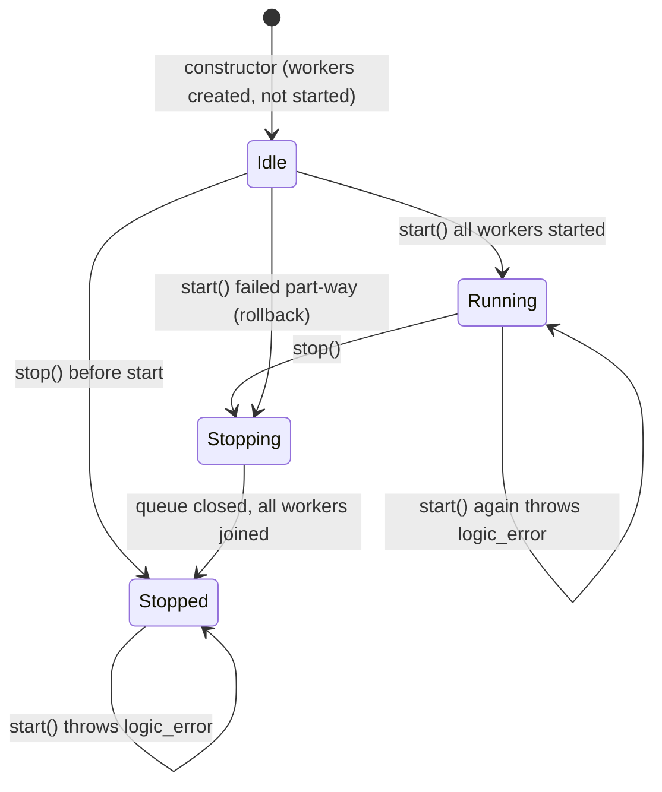

# Worker Lifecycle

This guide covers `Worker` and `WorkerPool` lifecycle behaviour from Commits 9.1 and 9.2. Verification: `jobq_worker_lifecycle` (`tests/worker_lifecycle_test.cpp`), `jobq_worker_shutdown` and `jobq_fault_injection`.

---

## 1. Three Different Lifecycles

| Lifecycle | Owner | States (as in the source) |
|---|---|---|
| Worker | `Worker` | Private enum `State { Created, Running, Joined }`, guarded by a mutex. |
| WorkerPool | `WorkerPool` | Three booleans: `started_`, `stopping_`, `stopped_`, guarded by the pool mutex. There is no enum. |
| Job | `Job` | `Pending`, `Running`, `Completed`, `Failed`, `Cancelled`. See [Job Lifecycle](job-lifecycle.md). |

A worker thread serves many jobs; a job may be executed by different workers across retries. The three lifecycles are independent.

---

## 2. Worker Lifecycle

| Operation | Behaviour |
|---|---|
| `start()` | Only valid from `Created`. Otherwise throws `std::logic_error` ("already started" or "joined and cannot be restarted"). The thread is created first and assigned to the member only on success, so a thread-creation failure leaves no joinable thread and the state stays `Created`. |
| `join()` | Joins a joinable thread and sets `Joined`. Idempotent. Works on a worker that never started. Throws `std::logic_error` if called from the worker's own thread; this check is lock-free so it cannot block behind another thread's `join()`. |
| `isCurrentThread()` | True only on the worker's own thread (an atomic thread id written when the thread starts running). |
| Destructor | Never throws. If the thread is still joinable it is joined, or detached if the destructor runs on that same thread. The queue must already be closed, otherwise the destructor blocks until it is. `WorkerPool` always closes the queue and joins first, so the destructor is only a safety net. |

### The execution loop (`Worker::run`)

The whole loop is inside an outer `try/catch (...)`, so nothing can escape the thread function and terminate the process.

`processJob` follows the normal per-job path: `markRunning()`, record execution started (metrics), `execute()`, `markCompleted()`, record completed. Any exception from that block records a failed execution (only if execution had started) and calls `handleJobFailure`, which marks the job failed, applies the retry policy, and calls `pushRetry()`. Retry scheduling exceptions are caught and logged. See [Fault Tolerance](fault-tolerance.md) for the exact outcomes.

Two layers of exception handling exist on purpose: the per-job layer (job failure, retry) and the outer layer (unexpected errors such as a failing queue wait). The outer layer logs the cause to `stderr` rather than hiding it.

---

## 3. WorkerPool Lifecycle

The labels Idle, Running, Stopping and Stopped describe combinations of the three booleans; they are not types in the code.

| Operation | Behaviour |
|---|---|
| Constructor | Throws `std::invalid_argument` for zero workers. Creates `Worker` objects; no threads yet. |
| `start()` | Under the pool mutex. Throws `std::logic_error` if stopping/stopped ("cannot be restarted") or already started. Starts workers in order; success sets `started_`. |
| Partial startup failure | If starting worker N throws (for example thread creation fails), the pool sets `stopping_`, releases the lock, closes the queue, joins every worker (started workers drain and exit; unstarted ones are marked joined), marks itself stopped and **rethrows the original exception**. The pool is never reported started. |
| `stop()` | Close and drain, see [Graceful Shutdown](graceful-shutdown.md). Idempotent. |
| Destruction | `stop()` in a `try/catch`. Workers are joined before the pool's members are destroyed. |
| `isStarted()` / `isStopped()` | Locked reads. `isStarted()` stays true after a normal stop. |

### Concurrency contract

- `start()` and `stop()` may be called from different threads. They are serialized by the pool mutex and the flags; a concurrent `stop()` during a failed startup waits for the rollback to complete.
- `stop()` may be called repeatedly and concurrently (tested with several threads).
- Neither `start()` nor `stop()` may be called from a worker thread (for example from a job handler). `stop()` detects this and throws `std::logic_error` before changing state; tested in `jobq_worker_lifecycle`. `Worker::join()` from its own thread throws as well.
- Lifecycle locks are never held while joining threads.

### What is verified and what is not

| Behaviour | Status |
|---|---|
| Repeated `Worker::start()` / `join()`, self-join, destructor joining | Tested (`jobq_worker_lifecycle`) |
| Repeated and concurrent `WorkerPool::stop()`, start-after-stop, stop-before-start | Tested |
| Pool destruction after failures | Tested (`jobq_fault_injection`) |
| `std::thread` creation failure and the partial-startup rollback | **Reviewed in code only.** Forcing thread creation to fail would need a production hook, which was deliberately not added. The test suite only exercises the worker state machine the rollback relies on. |
| Exception from `waitAndPop()` or an unexpected exception escaping `processJob` | Reviewed in code only; no deterministic injection point exists. |

### Limitations

- A `Worker` destroyed from its own thread is detached; the object may still be referenced by the exiting thread. This should not occur in normal use.
- Worker count is fixed at construction.
